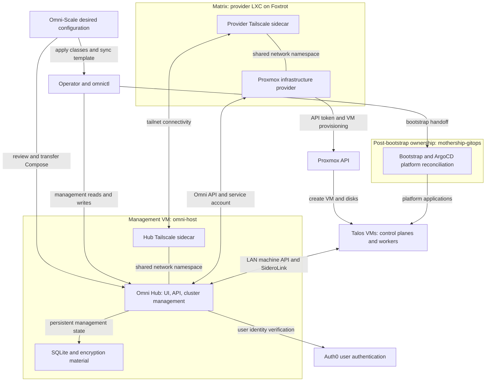

# Substrate architecture and ownership

Omni-Scale owns the **creation and operation of the Talos substrate**, not the applications installed on Kubernetes. Its management plane is a self-hosted Omni Hub on a Docker VM; its provisioning plane is a Proxmox infrastructure provider running with a Tailscale sidecar inside an LXC on Matrix. The provider creates Talos VMs through the Proxmox API. Talos nodes then register with Omni through SideroLink. Post-bootstrap platform reconciliation belongs to the separate `mothership-gitops` repository.

The important distinction is between **repository intent**, **deployed configuration**, and **observed runtime state**. A committed template or image reference is not evidence that a deployment has adopted it.

## Components and control flow


*Management intent flows through Omni and the provider to Proxmox, while node registration uses LAN reachability and application reconciliation crosses a separate GitOps ownership boundary.*

### Management plane

Omni owns the management UI/API, cluster resources, machine registration, and Kubernetes proxy. The Hub's Compose service shares the `omni-tailscale` network namespace and waits for its `tailscale status` health check. Both containers have TUN access; Omni has `NET_ADMIN` for SideroLink. The sidecar publishes host-LAN ports for the UI/API (`443`), machine API (`8090`), Kubernetes proxy (`8100`), and WireGuard (`50180/udp`).

Tailscale supplies network access, **not Omni user authentication**. The documented deployment uses Auth0. Provider access is a different identity: an Omni service-account key supplied to the provider process. Proxmox access is yet another identity: an API token in the provider's read-only-mounted `config.yaml`.

### Provisioning plane

The provider is the bridge between Omni's machine requests and Proxmox VM creation. Its `--id` defaults to `matrix-cluster`; machine classes route auto-provisioning to that same `providerid`. Their `providerdata` defines VM resources, storage selection, network bridge, and worker placement. Changing that data is a provisioning-policy change, not an application deployment.

The provider shares `worker-tailscale`'s network namespace and waits for sidecar health. The provider sidecar explicitly sets `TS_USERSPACE=false` and requires TUN passthrough and capabilities. The unprivileged LXC must permit the TUN device and nesting: a working `tailscale ping` alone does not prove ordinary container traffic can use the tunnel.

### Talos cluster

The checked-in `talos-prod-01` template requests three control planes and one worker each on Foxtrot, Golf, and Hotel. Workers are pinned through their machine classes; the control-plane class has no node pin and placement is provider-distributed. The template currently requests Talos `v1.13.6` and Kubernetes `v1.36.2`; these are desired versions, not a live inventory.

The template disables the default CNI and kube-proxy for subsequent Cilium installation. It includes `iscsi-tools`, `nfsd`, and `util-linux-tools`, and gives workers a shared bind mount from `/var/local/longhorn` into kubelet's `/var/lib/longhorn`. This repository owns those **node prerequisites**; it does not own Longhorn's Helm values, StorageClasses, or backup policy.

Sources: [Hub Compose](../../omni/compose.yml), [provider Compose](../../proxmox-provider/compose.yml), [deployment runbook](../../docs/DEPLOYMENT.md), [cluster template](../../clusters/talos-prod-01.yaml), and [provider setup](../../.agents/skills/omni-talos/references/provider-setup.md).

## Desired state is not deployed state

| Layer | Repository authority | Deployment or observation boundary |
|---|---|---|
| Hub services | `omni/compose.yml` and `omni/omni.env.example` describe intended services and configuration inputs. | The documented VM is `omni-host`, not the underlying Proxmox host Holly. `/home/ansible/docker/omni/compose.yaml` is **not in a git clone**; reviewed changes must be transferred and applied there. |
| Provider | `proxmox-provider/compose.yml`, credential examples, and machine-class provider data describe intended provisioning configuration. | Inspect the running provider image ID/digest and build provenance before choosing a replacement. |
| Cluster | Machine classes plus `clusters/talos-prod-01.yaml` describe desired VM policy and cluster topology. | `omnictl apply` installs classes; `omnictl cluster template sync` submits cluster intent. Read live machine and cluster status afterward. |
| Platform | This repo documents substrate prerequisites and the handoff. | `mothership-gitops` owns bootstrap, ArgoCD app waves, Longhorn configuration/backups, External Secrets, Tailscale Operator manifests, ingress, monitoring, and workloads. |

The checked-in Hub image is `ghcr.io/siderolabs/omni:v1.9.3`, and its sidecar uses floating `tailscale/tailscale:stable`. Neither establishes the running version. The provider's `:local-fix` reference is an explicit **desired-state reconciliation gap**: current provider guidance says the hostname workaround was superseded upstream by NoCloud metadata delivery. Older README/runbook advice that a patched build is mandatory is historical, not a safe redeployment instruction. Neither `latest` nor `local-fix` proves image contents or compatibility. Compare the actual running digest with source/build metadata and review provider/Omni compatibility before replacing it.

The documented historical hostname workaround is useful context, not evidence of current image contents or a successful rollout. Current guidance is in the [Hub lifecycle skill](../../.agents/skills/omni-upgrade/SKILL.md) and [provider image guidance](../../.agents/skills/omni-talos/references/provider-setup.md).

## Persistence boundaries

| State owner | Persistent material | Architectural consequence |
|---|---|---|
| Omni Hub | `${ETCD_VOLUME_PATH}` mounted at `/_out/etcd`; example host path `/etc/etcd/`; SQLite path `/_out/etcd/omni.db`. | The historical **etcd** naming does not make this a Hub etcd deployment: the command uses `--sqlite-storage-path`. This is management state, distinct from Kubernetes control-plane etcd on Talos VMs. |
| Hub encryption and TLS | `${ETCD_ENCRYPTION_KEY}` mounted read-only at `/omni.asc`, selected by `--private-key-source`; TLS cert/key mounted at `/tls.crt` and `/tls.key`. | Preserve encryption material securely with recovery planning. The GPG key must not require an interactive passphrase. TLS files are separate from the database. |
| Hub and provider sidecars | Each Compose stack binds its own `./tailscale-state` to `/var/lib/tailscale`. The Hub also sets `TS_AUTH_ONCE=true`. | Container replacement must retain device identity. Do not delete state to fix login or use destructive volume/state cleanup as routine recovery. Persisted state still does not prove a device remains registered. |
| Talos control-plane disks | `matrix-control-plane`: 4 cores, 8192 MiB RAM, 40 GB disk, `local-lvm`. | Current provisioning selects local NVMe-oriented storage for etcd latency, **not Ceph**. |
| Talos worker disks | Worker classes: 8 cores, 16384 MiB RAM, 100 GB disk, `vm_ssd` Ceph RBD, pinned per host. | VM disks and worker-local filesystem prerequisites are separate from GitOps-owned Longhorn replication and backup policy. |

The deployment prerequisite claiming Ceph control-plane storage, and the template comment saying all six nodes use Ceph, are stale relative to the executable class selectors. Use `local-lvm` for the current control-plane intent and `vm_ssd` for worker intent; verify actual disks in Proxmox before describing deployed placement.

Losing the Omni database does not delete the VMs. The runbook records a reset leaving a VM reporting resources the new Hub no longer recognized, producing `Links... doesn't exist` reconciliation loops. Treat management state and VM state as coordinated recovery concerns, not interchangeable backups. Use a consistent SQLite backup method and preserve required keys; a host-local copy alone is not tested disaster recovery.

Sources: [environment example](../../omni/omni.env.example), [control-plane class](../../machine-classes/matrix-control-plane.yaml), worker classes for [Foxtrot](../../machine-classes/matrix-worker-foxtrot.yaml), [Golf](../../machine-classes/matrix-worker-golf.yaml), and [Hotel](../../machine-classes/matrix-worker-hotel.yaml), plus the [Hub recovery guidance](../../.agents/skills/omni-upgrade/SKILL.md).

## Operational invariants and verification

- **Fresh nodes need LAN access before registration.** The documented design places the provider on the Talos L2 network. Split-horizon DNS resolves the same Omni hostname to its LAN IP for nodes and to its Tailscale address for tailnet clients. Proxmox host DNS must use the local resolver so booting VMs do not inherit public DNS and resolve an unreachable tailnet address. See [Network and identity](../concepts/network-and-identity.md).
- **Sidecar health is a prerequisite, not end-to-end proof.** When replacing the Hub sidecar, recreate Omni against the new sidecar afterward; a simple restart can leave the configured namespace target stale. Verify actual process network namespaces, LAN/tailnet HTTPS with valid TLS, and authenticated management reads.
- **Hub compatibility gates cluster upgrades.** Upgrade the Hub before submitting unsupported Talos/Kubernetes versions. Current upgrade guidance requires sequential minor-version review and health checks, and treats migrations as not reliably reversible. See [Hub lifecycle](../operations/hub-lifecycle.md).

Useful read-only acceptance checks are:

```bash
omnictl get sysversion -o jsonpath='{.spec.backendversion}'
omnictl get talosversions -o jsonpath='{.metadata.id}'
omnictl get infraprovidercombinedstatus matrix-cluster
omnictl get infraproviderhealthstatus matrix-cluster
omnictl get machines
omnictl get clusterstatus
```

A stored provider registration does not establish live connectivity; inspect combined health. Likewise, HTTP success alone does not prove all machines are connected or the cluster is available. These runtime checks complement applying configuration rather than being implied by it.

For the end-to-end entry path, see [Quickstart](../quickstart.md). For desired-state edits and submission, see [Cluster changes](../workflows/cluster-changes.md). For the ownership transition after bootstrap, see [GitOps handoff](../integrations/gitops-handoff.md) and the repository's [operations boundary](../../docs/OPERATIONS.md).
