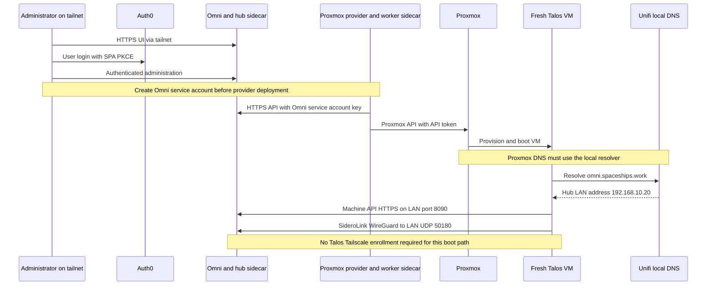

# Network, DNS and identity dependencies

Omni has two access paths, not one VPN-dependent bootstrap path. Administrators and the Proxmox provider use the tailnet to reach the hub. Fresh Talos VMs reach the hub over the LAN for the machine API and SideroLink WireGuard connection, without first enrolling in Tailscale. Both HTTPS paths use `omni.spaceships.work`, so routing can change without changing the TLS identity.

This is the connectivity contract of the [substrate](../architecture/substrate.md). It is distinct from the later Tailscale Operator and workload ingress owned by the [GitOps handoff](../integrations/gitops-handoff.md).

## Boot and access sequence


*The user/provider tailnet path and Talos LAN bootstrap path reach the same hub through different network entrances.*

The deployment gates are deliberately separate: first reach the UI and log in through Auth0, then create a provider service account, then verify the provider connects, and finally verify a new VM registers through SideroLink. A healthy UI alone does not prove the Talos boot path works. See the [deployment workflow](../workflows/deploy-substrate.md).

## DNS is part of bootstrap configuration

The [deployment runbook](../../docs/DEPLOYMENT.md) specifies split-horizon DNS:

| Resolver context | Answer for `omni.spaceships.work` | Intended consumers |
|---|---|---|
| Public Cloudflare DNS | Hub sidecar's `100.x.y.z` tailnet address | Tailnet administrators and provider |
| Local Unifi DNS | Hub host's `192.168.10.20` LAN address | Fresh Talos VMs and LAN clients |

A public DNS record containing a tailnet address does **not** make Omni publicly routable. The client still needs tailnet connectivity. Conversely, a LAN client may use the LAN entrance when its resolver returns the local answer.

The runbook records that Talos VMs inherit Proxmox host DNS settings during initial boot. All participating Proxmox nodes must therefore use the Unifi gateway resolver, such as `192.168.10.1`. A host configured with `1.1.1.1` or `8.8.8.8` bypasses the local override: the fresh VM gets a tailnet address it cannot route to and fails registration. Verify the resolver on every eligible Proxmox node, not just the provider LXC. The runbook's separate worker-LXC public-resolver workaround is not a recommendation to give Talos boot hosts public DNS.

### L2 placement versus routed hub reachability

The repository's [architecture reference](../../.agents/skills/omni-talos/references/architecture.md) specifies provider/Talos network adjacency: the provider LXC at `192.168.3.10` shares the Matrix `192.168.3.x` L2 network with the VMs. Preserve that documented placement requirement when moving the provider. The hub is on a **different subnet**, `192.168.10.0/24`; the same reference requires static routing between it and `192.168.3.0/24` for LAN SideroLink access.

Do not confuse those two requirements with a need to put the hub on the VMs' L2 segment. The reference describes local discovery, but the checked-in deployment configuration exposes explicit machine API and WireGuard destinations; it does not establish a detailed broadcast-discovery implementation. Validate VM-to-hub routing and local DNS in addition to provider placement.

## Listening ports, advertised addresses, and TLS

Three settings must agree:

1. **Bind addresses** tell Omni where to listen inside its shared network namespace.
2. **Compose port publication** makes those listeners reachable through the host LAN IP.
3. **Advertised addresses** tell clients which destination to use. Publishing a port does not repair an incorrect advertised URL.

The current [hub Compose](../../omni/compose.yml) publishes ports on the **sidecar**, because Omni uses `network_mode: "service:omni-tailscale"`. Values below come from [the example environment](../../omni/omni.env.example); `${HOST_IP:-192.168.10.20}` is the host binding used for all four published ports.

| Function | LAN publication | Listener / advertised endpoint |
|---|---|---|
| UI and Omni API | TCP `443:443` | `BIND_ADDR=0.0.0.0:443`; `ADVERTISED_API_URL=https://omni.spaceships.work` |
| Talos machine API | TCP `8090:8090` | `MACHINE_API_BIND_ADDR=0.0.0.0:8090`; `SIDEROLINK_ADVERTISED_API_URL=https://omni.spaceships.work:8090/` |
| SideroLink WireGuard | UDP `50180:50180` | `SIDEROLINK_WIREGUARD_ADVERTISED_ADDR=192.168.10.20:50180` |
| Kubernetes proxy | TCP `8100:8100` | `K8S_PROXY_BIND_ADDR=0.0.0.0:8100`; `ADVERTISED_K8S_PROXY_URL=https://omni.spaceships.work:8100/` |
| Event sink | **Not host-published** in Compose | `EVENT_SINK_PORT=8091` is passed to Omni |
| Provider → Omni | No provider inbound ports published | `--omni-api-endpoint=${OMNI_API_ENDPOINT:-https://omni.spaceships.work/}` |
| Provider → Proxmox | Not a Compose host publication | Example target `https://192.168.3.5:8006/api2/json` |

Explicit LAN publication matters even when tailnet access works. The runbook records a LAN-only `ERR_CONNECTION_REFUSED` failure fixed by adding the host-IP `443` mapping. Changing `HOST_IP` also requires reviewing LAN DNS, the advertised WireGuard address, and routing; those values are not derived automatically from each other.

### One HTTPS name across both horizons

The hub mounts `TLS_CERT` and `TLS_KEY` read-only, then supplies the same `/tls.crt` and `/tls.key` to both its main HTTPS API and machine API. Certificates must cover the hostname clients actually use. Keep the shared hostname on both DNS horizons rather than advertising an unrelated `omni-internal` name without matching certificate names.

The runbook documents Certbot with Cloudflare DNS-01 for certificate issuance, and an earlier `x509` failure after hostname changes. Its historical recovery included deleting Omni data; **that is not a routine certificate or DNS repair procedure**. The same runbook records that wiping the database while existing VMs remain creates orphaned-machine reconciliation failures. Review [hub lifecycle](../operations/hub-lifecycle.md) before any state reset.

## Sidecars, capabilities, and persisted tailnet identity

Both application containers share their respective Tailscale sidecar's network namespace and wait for a `tailscale status` healthcheck through `condition: service_healthy`. This gates startup on that check, not on a complete end-to-end DNS, TLS, or provider authorization test.

The checked-in privileges are specific, not blanket `privileged: true`:

- Both sidecars mount `/dev/net/tun` and add `NET_ADMIN` and `SYS_MODULE`.
- Omni itself also mounts `/dev/net/tun` and adds `NET_ADMIN` for SideroLink.
- The worker sidecar explicitly sets `TS_USERSPACE=false`. The hub Compose does not explicitly set this variable.
- For an unprivileged provider LXC, the runbook requires nesting plus TUN access in the Proxmox LXC configuration:

```text
lxc.cgroup2.devices.allow: c 10:200 rwm
lxc.mount.entry: /dev/net/tun dev/net/tun none bind,create=file
```

The recorded worker failure was that `tailscale ping` worked while ordinary application connections timed out because the kernel interface was unavailable. A successful Tailscale-level probe is not enough to prove that a process sharing the namespace can route its traffic.

Both sidecars bind-mount `./tailscale-state` to `/var/lib/tailscale` and set `TS_STATE_DIR` to that path. The hub additionally sets `TS_AUTH_ONCE=true`, expressing authenticate-once behavior with saved identity rather than re-enrollment on every restart. The worker Compose does not set `TS_AUTH_ONCE`.

Treat this directory as identity state, distinct from Omni's database and from enrollment credentials. Preserve it across ordinary container recreation. **Saved state is not a backup of tailnet registration:** do not expect it to restore a device deleted from the tailnet; plan explicit re-enrollment with an authorized key when registration is gone. Likewise, losing state can cause a new identity or hostname collision while an old registration remains. The troubleshooting guide records the `omni-1` collision case. Here the state is a bind mount, so inspect actual mounts rather than assuming `docker compose down -v` removes that host directory.

Use placeholder examples in [the hub environment template](../../omni/omni.env.example) and [provider environment template](../../proxmox-provider/.env.example), not local credential files, when sharing configuration or incident reports.

## Four independent authentication domains

| Domain | Identity or credential | What it authorizes |
|---|---|---|
| Human user → Omni | Auth0 SPA application with PKCE and an enabled connection, documented with GitHub social login | User authentication for Omni administration |
| Provider → Omni | `OMNI_SERVICE_ACCOUNT_KEY`, supplied as `--omni-service-account-key` | Provider API authentication to Omni, independent of human login |
| Provider → Proxmox | `tokenID` and `tokenSecret` in mounted provider configuration | Proxmox API operations, independent of Omni service accounts |
| Sidecar → tailnet | `TS_AUTHKEY` for enrollment plus persisted sidecar state | Network membership and access under tailnet policy, not Omni user or provider authorization |

The provider service account is created in Omni after hub login; the runbook warns that its key is shown only once. The provider's [example configuration](../../proxmox-provider/config.yaml.example) separately targets the Proxmox API and sets `insecureSkipVerify: true` for self-signed certificates. That is a Proxmox TLS-verification setting, not permission to skip Omni TLS validation.

Auth0 callback, logout, and web-origin settings must match the Omni HTTPS origin. In `AUTH`, pass the Auth0 tenant domain **without** `https://`: the documented legacy flag prepends the scheme, and including it twice caused login failures. `INITIAL_USER_EMAILS` seeds initial administrators; `OMNI_ACCOUNT_UUID` identifies the self-hosted installation rather than supplying a login credential.

**tsidp is historical.** The runbook describes abandoning the self-hosted Tailscale identity-provider approach because of bootstrap/routing complexity and switching to Auth0. Old tsidp troubleshooting entries are not the implemented user-authentication architecture.

## Cilium MTU is a separate post-bootstrap dependency

Do not equate the hub sidecars, Talos SideroLink, and Kubernetes Tailscale ingress proxies. They operate at different stages. The [Cilium guide](../../docs/guides/CILIUM.md) records a Talos `siderolink` WireGuard MTU of `1280`; without the explicit Cilium override, pod networking ended up at `1280` and Tailscale Ingress throughput was observed around `22 KB/s`.

The required install/upgrade value for this deployment is `--set MTU=1450` (1500-byte NIC minus 50-byte VXLAN overhead). **The exact auto-detection path that selected 1280 on these nodes is not mapped.** Do not turn that observation into a claim that Cilium always chooses the smallest interface MTU.

Keep the override in installation inputs: a ConfigMap-only patch is overwritten on reinstall. Verify the live result after upgrades, even when the CLI reports success:

```bash
kubectl get cm -n kube-system cilium-config -o jsonpath='{.data.mtu}'; echo
# Expect: 1450
cilium status --wait
cilium connectivity test
```

Existing pod veth MTUs do not change in place. The documented repair restarts Cilium components and the Tailscale proxy StatefulSets so new pod interfaces pick up the value. Platform reconciliation belongs beyond the substrate handoff; the local guide currently records imperative Cilium management, not an ArgoCD-managed Cilium Application.

## Focused validation

Validate each boundary separately rather than testing only dashboard availability:

- **DNS and LAN:** resolve `omni.spaceships.work` from the Proxmox/VM boot context and confirm the LAN answer. Check cross-subnet routing and the four hub port publications with `docker compose ps`.
- **Sidecar and application path:** inspect sidecar logs and `tailscale status`, then test HTTPS from the worker network namespace. If Tailscale probes work but application traffic fails, check TUN access, kernel mode, and `tailscale0`.
- **TLS and human login:** confirm the shared HTTPS hostname works and Auth0 login succeeds without a certificate-name or double-scheme error.
- **Provider authorization:** check the provider is connected and healthy, then test actual VM creation/registration. Network reachability alone does not validate either API credential.
- **Pod data plane:** verify Cilium's configured MTU and run the connectivity test after installation or upgrade.

For symptom-led diagnosis, see [troubleshooting](../operations/troubleshooting.md) and the repository's [troubleshooting reference](../../docs/TROUBLESHOOTING.md).
