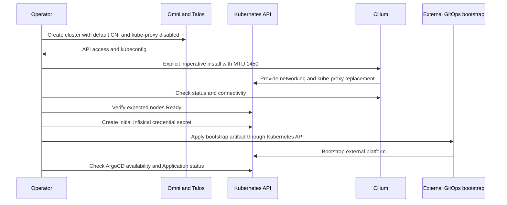

# CNI bootstrap and GitOps substrate contract

A created Talos cluster is not yet a usable platform. Omni-Scale owns the Omni Hub, Proxmox provider, machine classes, cluster templates, Talos node requirements and bootstrap handoff. Post-bootstrap application state belongs to [mothership-gitops](https://github.com/basher83/mothership-gitops), not this repository. API access, functional pod networking, storage-capable nodes and the initial secret must precede that handoff.

## Ownership and ordering

The [production template](../../clusters/talos-prod-01.yaml) deliberately sets `cluster.network.cni.name: none` and `cluster.proxy.disabled: true`. Set these **before cluster creation**: Cilium supplies networking and kube-proxy replacement afterward. Obtain kubeconfig from Omni and install the Cilium CLI before bootstrapping networking.


*The handoff requires explicit Cilium bootstrap before node-readiness gating and external GitOps verification.*

**Recovery automation gap:** [disaster-recovery.sh](../../scripts/disaster-recovery.sh) recreates the cluster, fetches kubeconfig and waits for all nodes Ready before applying GitOps. It does **not** install Cilium. With the checked-in CNI-disabled template, do not expect the script alone to bridge this gap: arrange the explicit Cilium installation after API access and before its Ready gate can pass. The script is destructive recovery automation, not a non-destructive bootstrap command. See [disaster recovery](../workflows/disaster-recovery.md) for the wider workflow.

## Cilium is currently imperative

The [Cilium guide](../../docs/guides/CILIUM.md) records CLI/Helm installation and explicitly states that no ArgoCD Application manages Cilium. GitOps-managed Cilium is a roadmap direction, **not implemented behavior**. The guide points to the [roadmap](../../docs/ROADMAP.md); the current roadmap emphasizes MTU durability and a future pod-MTU regression signal rather than documenting an implemented Cilium reconciliation path.

A basic Talos-compatible installation from the guide is:

```bash
cilium install \
    --set ipam.mode=kubernetes \
    --set kubeProxyReplacement=true \
    --set MTU=1450 \
    --set securityContext.capabilities.ciliumAgent="{CHOWN,KILL,NET_ADMIN,NET_RAW,IPC_LOCK,SYS_ADMIN,SYS_RESOURCE,DAC_OVERRIDE,FOWNER,SETGID,SETUID}" \
    --set securityContext.capabilities.cleanCiliumState="{NET_ADMIN,SYS_ADMIN,SYS_RESOURCE}" \
    --set cgroup.autoMount.enabled=false \
    --set cgroup.hostRoot=/sys/fs/cgroup \
    --set k8sServiceHost=localhost \
    --set k8sServicePort=7445
```

The explicit API endpoint `localhost:7445`, capabilities and Talos-managed cgroup settings are part of this bootstrap contract, not optional generic Kubernetes defaults. For Gateway API, the guide installs its CRDs before enabling Cilium's Gateway API options; use that guide for Gateway/Hubble variants rather than inferring them from the basic command.

### MTU is a durable input, not just a live patch

Carry **`--set MTU=1450` on every install and upgrade**: 1500-byte NIC MTU minus 50 bytes of VXLAN overhead. Repository observations record a `siderolink` WireGuard interface at MTU 1280 and pod networking ending up at 1280 without the override, with severe Tailscale Ingress throughput degradation. These are observations, not a mapped explanation of Cilium's selection path. The guide describes default-route-device MTU detection, **not** a rule that simply chooses the lowest-MTU interface; the exact path yielding 1280 on these Talos nodes remains unmapped.

After installation or upgrade, verify the actual state rather than trusting command success:

```bash
cilium status --wait
kubectl get nodes
kubectl get pods -n kube-system -l k8s-app=cilium
kubectl get cm -n kube-system cilium-config -o jsonpath='{.data.mtu}'; echo
cilium connectivity test
```

Expect the ConfigMap MTU to be `1450`. The guide documents an upgrade that returned success without updating the ConfigMap, so this readback matters. A direct ConfigMap patch is only a repair: a future `cilium install` overwrites it. Existing pod veth MTUs do not change during a pod's lifetime. The documented live repair restarts Cilium DaemonSets and the Tailscale proxy StatefulSets in `tailscale-operator` to recreate networking; keep the durable install/upgrade flag as well. Use [troubleshooting](../operations/troubleshooting.md) and the Cilium guide for repair details, and [network and identity](../concepts/network-and-identity.md) for access context.

## Talos storage and topology prerequisites

The production template supplies the substrate for Longhorn, not a Longhorn installation:

- Control planes and all three worker sets include `siderolabs/iscsi-tools`, `siderolabs/nfsd` and `siderolabs/util-linux-tools`.
- **Workers only** have a kubelet bind mount from `/var/local/longhorn` to `/var/lib/longhorn`, with `bind`, `rshared` and `rw` options. Preserve this node configuration when changing worker sets.
- Three single-worker sets use machine classes pinned to Foxtrot, Golf and Hotel, with matching `topology.kubernetes.io/zone` values `foxtrot`, `golf` and `hotel`. These are the checked-in placement and topology inputs, not proof of any external replica-placement policy.
- Do not rely on the generic examples' worker-role label: the production template comments out `node-role.kubernetes.io/worker` because NodeRestriction blocks it. Control-plane placement remains provider-distributed, not explicitly pinned by this template.

Longhorn Helm values, StorageClasses, backup policies and restore procedures remain external. Change substrate requirements through [cluster changes](../workflows/cluster-changes.md); consult the [external platform documentation](https://github.com/basher83/mothership-gitops/tree/HEAD/docs) for application-side storage operation.

## Secret and bootstrap artifact contract

The recovery script's `GITOPS_BOOTSTRAP` defaults to the sibling checkout's `mothership-gitops/bootstrap/bootstrap.yaml`, resolved relative to the repository's parent directory. Override `GITOPS_BOOTSTRAP` for another checkout location. Its prerequisite check requires that file to exist before destructive phases begin; the external source entry point is [bootstrap/bootstrap.yaml](https://github.com/basher83/mothership-gitops/blob/HEAD/bootstrap/bootstrap.yaml).

Before applying that artifact, the script creates `external-secrets` if necessary and requires the Secret `universal-auth-credentials` there. If absent, it prompts the operator to create it with Infisical credentials:

```bash
kubectl create secret generic universal-auth-credentials \
  --from-literal=clientId=<INFISICAL_CLIENT_ID> \
  --from-literal=clientSecret=<INFISICAL_CLIENT_SECRET> \
  -n external-secrets
```

After the prompt, absence of the Secret aborts execution. The script checks **existence**, not the keys or validity of credentials in an already-existing Secret. It then runs `kubectl apply -f "$GITOPS_BOOTSTRAP"`.

### What the script expects after handoff

These checks describe **local script expectations**, not inspected external application definitions or proof that this repository owns them:

| Gate | Script expectation |
|---|---|
| Nodes | Exactly `EXPECTED_MACHINES` nodes, default `6`, all with Ready=True, within 600 seconds |
| ArgoCD server | `argocd-server` Deployment in `argocd` reports a positive available-replica count within 300 seconds |
| Applications | Nonempty Application list in `argocd`; each is Synced and Healthy except `argocd-ha`, within 1200 seconds |

Timeouts print phase-specific diagnostics and fail the gate. The script's summary notes that `argocd-ha` needs manual sync if HA is desired; that exception is not blanket verification of HA readiness.

## Continue in the owning repository

Use GitHub entry points rather than treating a sibling checkout as documentation owned here:

| Responsibility | Source of truth |
|---|---|
| Bootstrap and operator entry point | [mothership-gitops README](https://github.com/basher83/mothership-gitops/blob/HEAD/README.md) |
| ArgoCD App of Apps | [apps/root.yaml](https://github.com/basher83/mothership-gitops/blob/HEAD/apps/root.yaml) |
| ArgoCD HA | [apps/argocd](https://github.com/basher83/mothership-gitops/tree/HEAD/apps/argocd) |
| ESO wiring, Tailscale Operator, monitoring and workloads | [platform applications](https://github.com/basher83/mothership-gitops/tree/HEAD/apps) and [operations documentation](https://github.com/basher83/mothership-gitops/tree/HEAD/docs) |

This page intentionally does not mirror external app waves, Helm values, exposure rules, dashboards, StorageClasses or backup/restore runbooks. The boundary is documented in the repository [README](../../README.md) and [operations guide](../../docs/OPERATIONS.md).
