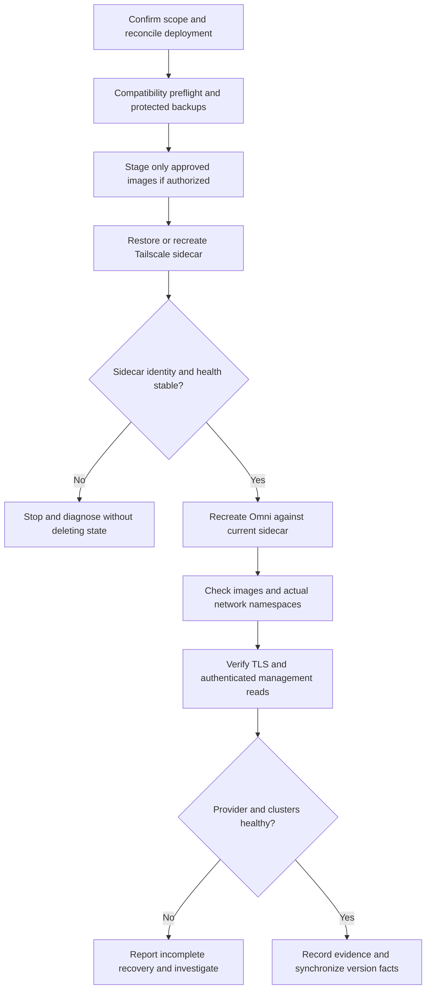

# Hub upgrades, persistent state and service recovery

The executable authority for this procedure is the current [omni-upgrade skill](../../.agents/skills/omni-upgrade/SKILL.md). Re-read it before execution: this page explains the safety model and verification boundaries, not a replacement automation entrypoint. [Operations](../../docs/OPERATIONS.md) delegates Hub upgrades to that skill and cluster rollouts to `omni-update-rollout`.

A Hub upgrade is **not** authorization to upgrade Talos or Kubernetes, replace a tailnet device, or destroy and rebuild a cluster. Hub versions gate the Talos and Kubernetes versions Omni accepts; establish backend support before changing cluster templates. See [cluster changes](../workflows/cluster-changes.md) for that separate workflow.

## Execution contexts and desired state

| Context | Responsibility |
|---|---|
| Workstation | Review release notes, reconcile repository and deployed configuration, transfer approved changes, and run the mise-managed `omnictl` for authenticated checks. |
| `omni-host` VM | Run Docker operations through `ssh root@omni-host`, in `/home/ansible/docker/omni`. The deployed file is `compose.yaml`. |
| Holly | Underlying Proxmox host, **not** the VM on which to execute this Compose procedure. |
| Provider LXC | Separate provider lifecycle; investigate it if provider connectivity does not return after Hub recovery. |

The deployment directory is **not a Git clone**. Editing [repository Compose](../../omni/compose.yml) does not deploy it, and a blind copy can destroy intentional deployment differences. First compare rendered deployed and repository configuration in memory, emitting only relevant non-secret differences. Refresh container IDs, resolved image IDs/digests, mounts, network attachments, health and restart counts; check for concurrent work. Reconcile differences before transferring the approved delta under the deployed filename. Commit, push or merge only within the approved publication scope.

The checked-in desired state currently pins `ghcr.io/siderolabs/omni:v1.9.3`, uses the floating `tailscale/tailscale:stable` reference, and pins workstation `omnictl` to `1.9.3` in [mise.toml](../../mise.toml). These are repository facts, **not proof of the deployed version**. Record resolved images before and after every change, especially for `stable`.

Compose requires explicit interpolation input:

```bash
ssh root@omni-host 'cd /home/ansible/docker/omni && \
  docker compose --env-file omni.env -f compose.yaml config --images'
```

`env_file: omni.env` supplies container environment; it does not replace `--env-file omni.env` for parsing `${TS_AUTHKEY}`, volume paths and command arguments. The file is not named `.env`. Do not print the environment file, unrestricted `docker inspect`, or the full rendered Compose model. Use narrow projections, for example:

```bash
ssh root@omni-host 'docker inspect --format \
  "{{.Name}} imageRef={{.Config.Image}} imageID={{.Image}} status={{.State.Status}} restarts={{.RestartCount}} net={{.HostConfig.NetworkMode}}" \
  omni-tailscale omni'
```

Inspect only the required fields of mounts, health and attachments separately; filter logs before sharing them. Authentication URLs and private keys do not belong in an operations transcript.

## Choose the authorized operation

| Operation | Boundary |
|---|---|
| Recovery without upgrade | Keep approved images and configuration. Before recreating with `--pull never --no-build`, confirm the local reference resolves to the recorded running image. A floating tag may have moved locally. |
| Staged image pull | Download only approved references. Pulling is staging, not proof of deployment or permission to upgrade. |
| Configuration change | Recreate the affected service to apply it. A restart neither pulls images nor applies changed environment. |
| Version upgrade | Check release compatibility and migrate sequentially, verifying each minor step. |
| Fresh tailnet enrollment | Separate identity/credential change. Stop if recovery requires it but approval does not cover it. |

For upgrades, read the [upstream upgrade policy](https://docs.siderolabs.com/omni/self-hosted/upgrading-omni), the **Urgent Upgrade Notes for every traversed minor**, and the target patch notes. One release-note entrypoint is:

```bash
gh api repos/siderolabs/omni/releases/tags/vX.Y.0 --jq .body
```

Compare removed CLI flags with both deployed and checked-in `command:` blocks. Follow the upstream-supported **one-minor-at-a-time** sequence, with health checks at each step; an image being available or a previous successful jump does not establish support for skipping minors. Match the CLI to the target backend; the skill specifically flags the Omni 1.11 API-version change as requiring a client upgrade with the backend.

**Database migrations are not guaranteed reversible. Treat rollback as unavailable and plan to roll forward.** Explicitly present this policy for approval when crossing multiple minors. A saved image and backup do not by themselves establish a supported downgrade path.

## Protect state before changing containers

The storage names retain historical `ETCD_*` terminology, but current Compose passes `--sqlite-storage-path=${OMNI_SQLITE_PATH}`. The [environment example](../../omni/omni.env.example) places the database at `/_out/etcd/omni.db`, inside `${ETCD_VOLUME_PATH}` mounted at `/_out/etcd`. Determine the **actual deployed backend and bind sources**, not just example defaults.

| Protected material | Why it matters |
|---|---|
| Actual Omni database and storage bind source | Holds Hub state; preserve the existing mounts during recreation. |
| `${ETCD_ENCRYPTION_KEY}` | Mounted read-only at `/omni.asc` and selected by `--private-key-source='file:///omni.asc'`; preserve the required encryption material for full recovery. |
| `./tailscale-state` | Bound at `/var/lib/tailscale`; preserves sidecar identity across container replacement. |
| Deployed Compose, environment, TLS certificate/key and account configuration | Required to reconstruct the intended configuration and access paths; treat recovery copies as sensitive. |

Create a restricted host-local recovery copy of configuration and state before mutation. For a running SQLite database, use the **SQLite backup API** rather than treating a raw live database-file copy as a consistent backup. Run an integrity check on the backup and require a successful result. Confirm that the backed-up database is the one selected by the deployed storage configuration.

Stop the sidecar for a consistent archive of its state directory; verify archive contents against the actual bind source. Account for that network interruption in the maintenance plan. Keep encryption material and secret-bearing archives protected, and do not emit their contents while verifying coverage. Never use `down -v`, prune state, remove bind directories, or delete Tailscale state to fix login.

A local recovery copy is not an off-host, tested disaster-recovery procedure. It does not prove successful restore, preserved tailnet registration, or reversibility of migrations. See [disaster recovery](../workflows/disaster-recovery.md) for the separate recovery scope.

### Persistent identity is not registration proof

Keep `TS_STATE_DIR=/var/lib/tailscale` on persistent storage and `TS_AUTH_ONCE=true`. An auth key bootstraps enrollment; expiry of that key does not expire an already authorized device. Tagged devices normally have node-key expiry disabled, but verify the setting after enrollment.

If login fails, inspect only state metadata and structural presence, then compare the saved node ID with tailnet inventory. Saved state does not prove the device remains registered. `TS_AUTH_ONCE` cannot recover a deleted registration. Do not silently replace credentials or identity when fresh enrollment is outside the approved scope.

## Apply in dependency order



*Lifecycle gates keep sidecar recovery ahead of Omni recreation and require authenticated, system-wide evidence before declaring success.*

1. **Restore the sidecar first** if it changed or was stopped for backup. A backup-only stop can use `docker start omni-tailscale`. To apply approved configuration changes, recreate it:

   ```bash
   ssh root@omni-host 'cd /home/ansible/docker/omni && \
     docker compose --env-file omni.env -f compose.yaml up -d \
       --no-deps --force-recreate --pull never --no-build omni-tailscale'
   ```

2. **Gate Omni changes on sidecar recovery.** Verify `Running`, `Online`, health, expected device identity/tags, and a stable restart count beyond the observed failure interval. Compose has a `tailscale status` healthcheck, but a container merely running is insufficient. Stop here if the gate fails.

3. **Recreate Omni against the current sidecar**, preserving storage and the approved image/command:

   ```bash
   ssh root@omni-host 'cd /home/ansible/docker/omni && \
     docker compose --env-file omni.env -f compose.yaml up -d \
       --no-deps --force-recreate --pull never --no-build omni'
   ```

Omni uses `network_mode: "service:omni-tailscale"`; the sidecar owns the published LAN ports. Compose also declares a healthy-sidecar dependency, but these explicit `--no-deps` operations rely on the manual gate above. When the sidecar container ID changes, restarting Omni alone leaves the old configured namespace target unchanged. Recreate Omni; do not assume a daemon restart or network attachment repair reconnects the existing process.

For the network ownership model, see [substrate](../architecture/substrate.md) and [network and identity](../concepts/network-and-identity.md).

## Prove recovery, not just reachability

First record post-change container and resolved image IDs/digests. Then compare the **actual** `/proc/<pid>/ns/net` identities of both processes. A configured network-mode reference is not proof that live processes share a namespace. For example, on the VM:

```bash
for c in omni-tailscale omni; do
  pid=$(docker inspect --format '{{.State.Pid}}' "$c")
  printf '%s ' "$c"
  readlink "/proc/$pid/ns/net"
done
```

Check interfaces/routes and LAN and tailnet HTTPS with valid TLS. Tailscale supplies network access, **not Omni user authentication**; the skill identifies deployed Omni as Auth0-backed. If authentication is in scope, refresh that fact using filtered deployed configuration rather than assuming the example remains authoritative.

Run authenticated reads from the workstation:

```bash
omnictl get sysversion -o jsonpath='{.spec.backendversion}'
omnictl get talosversions -o jsonpath='{.metadata.id}'
omnictl get infraprovidercombinedstatus matrix-cluster -o json
omnictl get machines
omnictl get clusterstatus
```

Require the intended backend version and expected version support. Inspect combined provider `spec.health`, all machines' `CONNECTED` values, and cluster availability/healthy counts. A stored `InfraProviderStatus` proves registration exists, not live provider connectivity. Neither HTTP 200 nor `running` alone proves recovery. If the CLI key expired, let the operator complete authentication and repeat the reads; mark pending checks and disconnected resources explicitly rather than claiming completion.

### Failure boundaries and closeout

- **Crash loop or unknown flag:** inspect sanitized Omni startup logs. Correct removed flags in repository Compose, re-sync and re-apply; do not alter state to compensate for a command-line incompatibility.
- **UI/API unreachable:** inspect sidecar attachments, interfaces/routes and actual namespaces. Restore only an approved missing attachment; this does not fix Auth0 authentication or reconnect an existing Omni process automatically.
- **Provider remains disconnected:** investigate the separate `omni-provider` LXC lifecycle using the [omni-talos skill](../../.agents/skills/omni-talos/SKILL.md), not destructive Hub changes.

After an upgrade, synchronize the `omnictl` pin, affected environment example fields and documentation naming the old version in the same session. Record sanitized evidence and resulting deployed state in Lab Operations. For symptom-led investigation, continue with [troubleshooting](troubleshooting.md).
