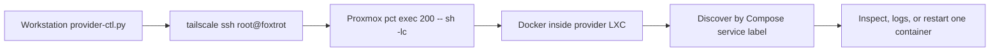

# Substrate troubleshooting and provider operations

Start with the failing boundary, collect read-only evidence, then change only the affected layer. A running container, a registered provider, and a working machine-to-Hub connection are three different observations.

This repository owns Omni, Talos, MachineClasses, cluster templates, and provider infrastructure. **Application incidents belong in [mothership-gitops](https://github.com/basher83/mothership-gitops)**, including ArgoCD reconciliation, Longhorn, ESO, Tailscale Operator manifests, ingress, monitoring, and workloads. If an application lacks worker capacity, repair the substrate here, then hand back to GitOps; do not copy application fixes into this repo. See [GitOps handoff](../integrations/gitops-handoff.md).

## Provider commands fail, or provider health is unclear

### Read-only checks from the workstation

Run the actual repository entrypoint, rather than assuming a top-level `scripts/provider-ctl.py` exists:

```bash
.agents/skills/omni-talos/scripts/provider-ctl.py --status
.agents/skills/omni-talos/scripts/provider-ctl.py --logs 50
.agents/skills/omni-talos/scripts/provider-ctl.py --logs 100 --raw
omnictl get infraproviders
omnictl get infraprovidercombinedstatus matrix-cluster
omnictl get infraproviderhealthstatus matrix-cluster
```

The helper needs the workstation `tailscale` executable and SSH access through Tailscale. It does not SSH directly into the LXC or run Compose locally:


*The helper traverses the Proxmox host to Docker inside the provider LXC; discovery precedes each action unless explicitly overridden.*

| Workstation environment override | Default | Meaning |
|---|---|---|
| `OMNI_PROVIDER_HOST` | `root@foxtrot` | Tailscale SSH destination |
| `OMNI_PROVIDER_CT` | `200` | LXC targeted by `pct exec` |
| `OMNI_PROVIDER_SERVICE` | `proxmox-provider` | `com.docker.compose.service` label value |
| `OMNI_PROVIDER_CONTAINER` | unset | Explicit container name, bypassing discovery |

Discovery uses `docker ps -a`, so stopped containers are included. **Zero matches and multiple matches both fail**, rather than guessing a generated name. The filter is service-only, not Compose-project-specific: two stacks with the same service label are ambiguous. Check the host, CT, and Docker inventory first; use an explicit container override only after identifying the intended object.

| Action | What it establishes | Limits |
|---|---|---|
| `--status` | Docker inspect state, timestamps, exit code, and health if present | Returns nonzero when stopped or when a reported health status is not `healthy`. A running container without a healthcheck succeeds; this is not an Omni connectivity test. |
| `--logs [N]` | Last 25 lines by default, capped at 100 | Snapshot, not follow mode. JSON is condensed to level/time/machine/step/job/message; `--raw` preserves fields. Non-JSON lines pass through. |
| `--restart` | Runs `docker restart`, then checks for a running container | Does not recreate from Compose, update image/environment, or verify provider health in Omni. |

Choose exactly one action; `--raw` requires `--logs`. Status and log remote calls each have a **10-second timeout**; restart discovery, restart, and running-state check each have **30 seconds**. These are per-call limits, not a single overall deadline. Transport timeout is represented internally as 124 and missing `tailscale` as 127, while action failures normally exit 1. A timeout can arise before Docker is reached; it does not identify the failed hop. A timed-out restart also does not prove the remote mutation was cancelled—inspect before retrying. See the [helper implementation](../../.agents/skills/omni-talos/scripts/provider-ctl.py).

### Provider is running but disconnected or unhealthy

Inside the provider LXC, inspect the sidecar and provider logs before restarting. The [provider Compose](../../proxmox-provider/compose.yml) shares `worker-tailscale`'s network namespace and waits for its `tailscale status` healthcheck. It mounts `config.yaml` read-only and uses:

- `OMNI_API_ENDPOINT`, default `https://omni.spaceships.work/`;
- `OMNI_SERVICE_ACCOUNT_KEY` for Omni authentication;
- `PROVIDER_ID`, default `matrix-cluster`;
- Proxmox API credentials in `config.yaml`, not inline Proxmox command flags.

Check endpoint reachability, Tailscale state, service-account validity, Proxmox API connectivity, and token permissions. Do not paste credentials into incident logs. The old troubleshooting instruction to force `--id=Proxmox` is not a universal fix: compare the deployed ID with the MachineClass provider reference instead. See [provider setup and verification](../../.agents/skills/omni-talos/references/provider-setup.md#verification) and [provisioning operations](../../docs/OPERATIONS.md#6-troubleshooting-provisioning).

**Scoped repair:** correct the specific credentials/configuration or transport failure. Environment or Compose changes require a reviewed recreation; `docker restart` retains the existing container configuration. A provider-only restart interrupts provisioning reconciliation but is narrower than restarting its shared sidecar or whole stack. Capture logs first, avoid overlapping provisioning changes, and verify afterward with both helper status and Omni's combined/health status objects. Registration alone is insufficient.

## Fresh Talos VMs boot but never register

### Check DNS and the advertised Hub path first

The recorded split-horizon incident had working VM boots but timeouts to `omni.spaceships.work`: public DNS returned a Tailscale address that fresh Talos VMs could not reach. Proxmox hosts used public resolvers rather than the local split-DNS resolver. Admin access over Tailscale therefore did not prove bootstrap connectivity.

1. Inspect Proxmox console output and machine logs, not just VM power state.
2. Check the resolver and answer used on the VM provisioning network. Compare the local answer with the public/Tailscale answer.
3. Check the Hub's advertised endpoints and actual LAN listeners/firewall path.
4. Inspect provider and machine status together:

```bash
omnictl get machines
omnictl get machine <machine-id> -o yaml
omnictl machine-logs <machine-id> --tail 100
```

The recorded local DNS answer is `192.168.10.20`; confirm the deployed address rather than treating that incident value as inventory. Current Hub Compose publishes `${HOST_IP:-192.168.10.20}` ports **443**, **8090**, **8100**, and **50180/udp** through `omni-tailscale`, with Omni sharing that namespace. Split DNS alone cannot fix a missing LAN listener. See [DNS incident](../../docs/TROUBLESHOOTING.md#split-horizon-dns-resolution-failure-the-four-day-boss-fight), [LAN port binding](../../docs/TROUBLESHOOTING.md#docker-lan-port-binding-hairpin-nat), and [network and identity](../concepts/network-and-identity.md).

**Repair and verify:** correct the resolver or LAN endpoint binding only after confirming the mismatch. Recheck resolution from the bootstrap network, then verify machine registration progresses and SideroLink becomes usable. Do not impose a same-L2 requirement or substitute generic Talos API ports for the configured Hub endpoints merely because an older debugging note says so.

### Hostname conflict: historical patch is not the current prescription

For `static hostname is already set in v1alpha1 config`, collect machine logs and the **running provider artifact identity**. The old “Requires Local Patch” section describes removal of `configureHostname`, which injected `machine.network.hostname`. The newer [provider image reference](../../.agents/skills/omni-talos/references/provider-setup.md#provider-image) explains that upstream [commit 559954c](https://github.com/siderolabs/omni-infra-provider-proxmox/commit/559954c759bd5b2cf319bcc0ac8c974bdb6621bb) removed that step and moved hostname delivery to NoCloud metadata.

**Do not rebuild the old patch by default.** Checked-in Compose still says `:local-fix`, explicitly marked historical and requiring reconciliation. Neither `latest` nor `local-fix` proves contents, freshness, compatibility, or deployed provenance.

Inside the provider LXC, resolve exactly one container by service label, then use the [read-only provenance procedure](../../.agents/skills/omni-talos/references/provider-setup.md#provider-image) to inspect its configured image, image ID, digests, creation time, and revision labels. Compare registry platform manifests and upstream build logs with the running artifact. If revision metadata is absent, compare executables before claiming source ancestry. Record dated evidence in the change/incident record; review Omni/provider compatibility before any image change. The historical section's September 17, 2026 provenance follow-up is a dated external record, not proof for a future deployment.

## Hub access fails, or a shared namespace disappears

Read-only checks on the Hub host:

```bash
cd omni
docker compose ps
docker compose logs --tail 100 omni omni-tailscale
docker exec omni-tailscale tailscale status
sudo ss -tlnp
```

Compare the [actual Hub Compose](../../omni/compose.yml) with the error:

- Missing SQLite path: Compose passes `--sqlite-storage-path=${OMNI_SQLITE_PATH}`; the documented default is `/_out/etcd/omni.db`. Check configuration and storage mounts, not a new empty database.
- Missing TUN: check `/dev/net/tun` device access and capabilities. Compose uses `devices`, not a bind mount under `volumes`.
- Startup DNS failure: current healthcheck is `tailscale status`, **not** the stronger DNS-probing example in troubleshooting. Do not assume it proves every dependency is reachable.
- `joining network namespace of container: No such container`: the historical repair is whole-stack `docker compose down && docker compose up -d`. This interrupts Hub access and machine/proxy connections; capture evidence and plan the outage first.

Never add `-v` as routine cleanup: losing Tailscale state can leave stale devices and cause hostname suffixes. Do not follow historical tsidp fixes as current authentication guidance; that section explicitly records migration to Auth0. For `invalid signature`, verify context and retry the OIDC flow per [authentication operations](../../docs/OPERATIONS.md#3-authentication). Clearing Omni storage is destructive recovery, not a first-line identity fix. Use [Hub lifecycle](hub-lifecycle.md) and [disaster recovery](../workflows/disaster-recovery.md) for disruptive changes.

## Provisioning or scaling stalls before usable nodes appear

Read provider logs, `omnictl get machineclasses`, cluster status, and the failing MachineClass before changing VM state. On Proxmox, `pvesh get /storage` checks actual pool names. A selector that names nonexistent storage can stall scaling; use an exact `name` match rather than the historical failing `type == "rbd"` expression. Validate template structure as separate YAML documents; Omni expects one `ControlPlane` section, not several per-node control-plane sections. See [MachineClass operations](../../docs/OPERATIONS.md#4-machine-classes) and [cluster changes](../workflows/cluster-changes.md).

For a reboot loop with `is not allowed to modify labels: node-role.kubernetes.io/worker`, inspect `machine.nodeLabels`: NodeRestriction blocks kubelet assignment of that protected label. Remove the protected key or use a custom namespace such as `omni.sidero.dev/role`; do not repeatedly reboot unchanged configuration. See [recovery procedure](../../.agents/skills/omni-talos/references/recovery-procedures.md#node-stuck-in-reboot-loop).

If large responses, exec, or ingress stall rather than provisioning itself, compare `cilium-config` MTU, actual pod MTU, and the Talos `siderolink` interface; also check `tailscale ping` for a relayed path. The documented substrate mitigation is explicit Cilium `MTU=1450`. The precise auto-detection path to 1280 and the ingress performance mechanism are not fully proven. Use the [MTU runbook](../../docs/TROUBLESHOOTING.md#cilium-mtu-auto-detect-poisoning-the-silent-assassin), and coordinate platform changes with GitOps. ConfigMap patches and pod/DaemonSet restarts are mutations, not diagnostic commands.

## Machine stays Destroying, or direct deletion is denied

First correlate the Omni UUID with Proxmox inventory and confirm whether the VM still exists. Out-of-band VM deletion can leave finalizer-protected resources. `machines.omni.sidero.dev` is read-only even for Admins; the documented recovery targets the owning `clustermachine`:

```bash
# Read-only inventory first
omnictl get machines -o table
omnictl get clustermachines

# Mutation: only after confirming the intended UUID and missing VM
omnictl delete clustermachine <machine-uuid>

# Verify cleanup and any replacement activity
omnictl get machines -o table
omnictl get machineclasses
```

Use the [state-drift recovery procedure](../../.agents/skills/omni-talos/references/recovery-procedures.md#state-drift-after-out-of-band-changes). Deletion can affect cluster membership and trigger replacement; protect control-plane quorum and workload/data recovery first. **Finalizer removal is not the normal documented repair**: it bypasses lifecycle safeguards and can orphan infrastructure. Escalate with resource ownership and cleanup evidence rather than force-removing finalizers to hide a symptom.

Manual `qm destroy`, cluster-template deletion, and delete/recreate recovery destroy resources and may lose data. Require explicit scope, backups/restore plan, and confirmation of affected machines. The old migration incident's “fundamental constraint” wording is not a demonstrated general Talos invariant; treat it as a historical warning, not authorization to destroy a cluster or proof that all migration is impossible.

## Considering VM optimization for a performance symptom

[`proxmox-vm-optimize.sh`](../../scripts/proxmox-vm-optimize.sh) is an **optional post-install mutation tool**, not part of normal provider provisioning. Run it directly on a Proxmox node with `qm`, not on the workstation or inside the provider container. It defaults to dry-run and skips running VMs unless `--include-running` is supplied.

```bash
# On the owning Proxmox node: preview explicitly scoped VMs
./proxmox-vm-optimize.sh --vmids 100,101
qm config 100
```

The script intends to rewrite selected SCSI options (`ssd`, discard, iothread, cache, aio), optionally alter CPU/chipset/NUMA/hugepages with `--gpu`, or add `net1` with `--add-10g-nic`. Review exact VM IDs, slots, existing config, storage/bridge support, and downtime before `--apply`. GPU mode also changes ballooning and QEMU arguments; NIC creation skips an existing `net1`. Broad name matching and `--include-running` expand the blast radius.

Inspect the actual preview and resulting `qm config`; a completion banner is not proof that every requested setting changed. Some optional-setting failures only warn. These source-inspected behaviors are **not an end-to-end validation** on Proxmox. After an approved apply, verify boot, network/storage access, Omni machine health, and Kubernetes readiness; retain the pre-change configuration for rollback.

## Evidence freshness

The [April 28, 2026 audit](../../docs/audits/AUDIT_REPORT_2026-04-28.md) is a dated documentation-drift report, not live infrastructure truth. Its warnings about stale service names, environment keys, and paths explain why this page favors checked-in Compose and helper behavior over copied incident commands. Recheck running artifacts and live status at incident time; keep dated findings separate from permanent operating requirements.
