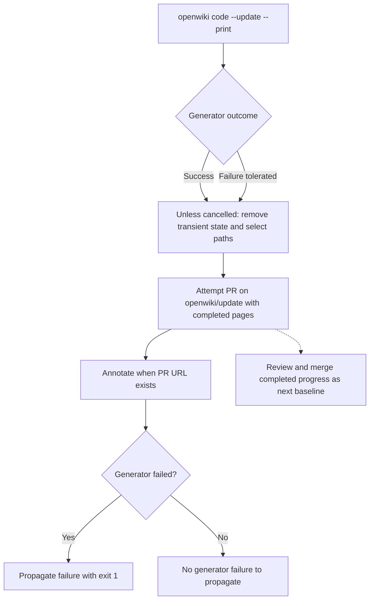

# Local checks, CI and infrastructure verification

## What a green check means

The inspected quality gate is **static validation, not an end-to-end infrastructure or disaster-recovery test suite**. `mise run check` runs `pre-commit run --all-files`; CI invokes the same task. It does not deploy Compose services, provision VMs, exercise cluster bootstrap, or run recovery. Offline template success cannot establish DNS resolution, credentials or permissions, provider/version compatibility, resource availability, or bootstrap readiness. Those require separate, explicitly authorized operational verification.

CI runs on pull requests and pushes to `main`, with read-only repository contents permission, an Ubuntu runner, a ten-minute job timeout, and cancellation of earlier runs in the same workflow/ref group. It checks out the repository, installs quality-gate tools through mise, then runs the gate. There is no deployment or recovery step in this workflow. See [CI](../../.github/workflows/ci.yml), [tasks](../../mise.toml), and [hooks](../../.pre-commit-config.yaml).

## Local entrypoints and side effects

Run from the repository root:

```sh
mise run check
# Equivalent hook invocation, with required system tools already available:
pre-commit run --all-files

# Explicitly validate both checked-in cluster templates:
mise run validate:omni
```

Do not describe the complete gate as strictly read-only or network-free:

- mise enables automatic installation, including installation during task execution, and configures creation of `.venv`. Initial setup can download tools; pre-commit can install hook environments.
- `trailing-whitespace` and `end-of-file-fixer` can rewrite files. Inspect `git diff`, stage intended fixes, and rerun the gate.
- `shfmt -d` and `rumdl check` report rather than apply formatting. The separate `mise run markdown-fix` task uses `rumdl fmt .` and **does** modify Markdown.
- `mise run hooks-install` changes local hooks and also installs an Infisical pre-commit hook. `mise run infisical-scan` is a separate task, not an explicit step in the inspected CI gate. The gate's private-key/AWS-credential checks are not a substitute for a full secrets review.

With tools already installed, individual parser/linter invocations can inspect source without infrastructure mutation. That is different from claiming the entire setup and gate are side-effect-free. [Task configuration](../../mise.toml)

## Actual check coverage and limits

`--all-files` means all eligible tracked files, not every file regardless of hook filters. A normal pre-commit invocation without that flag is scoped to staged files. The configured filters remain important:

| Check | Scope and behavior | What it does not prove |
|---|---|---|
| YAML parsing | `check-yaml` uses `--allow-multiple-documents` on YAML files, allowing the `---`-separated cluster sections. | Not application/provider schema validation. In particular, `providerdata: |` is a scalar string to the outer YAML parser, not a separately validated provider document. |
| Omni templates | Local hook matches `^clusters/.*\.ya?ml$`, passes no filenames, and invokes `mise run validate:omni`. The task always validates `clusters/talos-prod-01.yaml` and `clusters/test/test-cluster.yaml` using `omnictl cluster template validate -f`. | Offline validation, not sync/provisioning. A new third template is not automatically added to the task, even if it triggers the hook. Machine-class-only changes do not trigger this hook. |
| Shell | Files identified as `shell`: `shellcheck --severity=warning` and `shfmt -d -i 2 -ci`. | No execution, mocked command tests, SSH/API checks, or proof that destructive branches are safe. |
| Python | `check-ast` parses Python files, including Python operational helpers when eligible. | No imports, type checking, unit-test execution, subprocess execution, or remote behavior verification. |
| Workflow lint | `actionlint` on `^\.github/workflows/.*\.ya?ml$`. | No actual GitHub runner, action download, authentication, or deployment exercise. |
| Renovate | Hook from `renovatebot/pre-commit-hooks` at `42.70.2`, with `--strict`. | Configuration validation is not proof that every regex will extract the desired dependency or that an upgrade boots. |
| Markdown | `rumdl check` only on `README.md`, `clusters/README.md`, `machine-classes/README.md`, and `scripts/README.md`. | Not a repository-wide documentation gate. The separate `mise run markdown-lint` uses `rumdl check .`. |
| General hygiene | Whitespace/EOF fixes, large added files, executable/shebang consistency, private keys, AWS credentials (`--allow-missing-credentials`), JSON, merge conflicts, and symlinks. | Not a comprehensive security audit or runtime test. |

The hook configuration is the authoritative filter list; the mise tool versions and hook revisions are independently pinned. [Hooks](../../.pre-commit-config.yaml), [mise](../../mise.toml)

## Generated-wiki maintenance: a separate PR lifecycle

[OpenWiki Update](../../.github/workflows/openwiki-update.yml) is configured for manual `workflow_dispatch` and a daily **08:00 UTC** schedule. It regenerates documentation and proposes a PR; it does **not** deploy infrastructure or replace the static CI gate. The inspected workflow alone establishes no successful completed GitHub Actions run. Check actual workflow outcomes, logs, and the generated PR before relying on automatic refresh.

### Configuration and access

The workflow checks out full history (`fetch-depth: 0`) so `openwiki code --update` can compare HEAD with the commit last documented; a shallow checkout can hide that baseline and leave an empty change summary. It connects to the tailnet with `TS_OAUTH_CLIENT_ID` and `TS_AUDIENCE` secrets, `tag:ci`, and a ping to `agents`, providing access to the configured OpenAI-compatible endpoint. It installs Node **22** and pins `openwiki@0.9.0`, `mermaid@11.16.0`, and `jsdom@29.1.1`; the latter two support diagram validation.

The run selects `OPENWIKI_PROVIDER=openai-compatible`, the endpoint via `OPENAI_COMPATIBLE_BASE_URL`, Responses API via `OPENWIKI_OPENAI_COMPATIBLE_USE_RESPONSES_API=true`, model via `OPENWIKI_MODEL_ID`, and **page concurrency 4** via `OPENWIKI_PAGE_CONCURRENCY`. Authentication configuration uses `OPENAI_COMPATIBLE_API_KEY`; the LangSmith connector uses the `OPENWIKI_LANGSMITH_API_KEY` secret. Optional run tracing uses the `LANGSMITH_API_KEY` secret with `LANGCHAIN_PROJECT` and `LANGCHAIN_TRACING_V2`. Consult the workflow for authoritative settings rather than copying credentials into docs or logs. Its permissions are `contents: write`, `pull-requests: write`, and `id-token: write`.

### Partial progress is intentional

`openwiki code --update --print` runs with `continue-on-error: true`: a generator failure is recorded in `steps.openwiki.outcome` without immediately preventing progress collection. Unless cancelled, subsequent steps remove transient `openwiki/.run.json` and explicitly select only `openwiki`, `AGENTS.md`, `.github/workflows/openwiki-update.yml`, and **`CLAUDE.md` only when present** for staging. The existence check avoids a missing path causing `git add` to stage nothing.

The PR action uses branch `openwiki/update`, with commit message and title `docs: update OpenWiki`. Its body reports the generator outcome and explains that, on failure, the PR intentionally preserves pages completed before the failure. Review and merge useful completed progress to establish the next run's baseline; a failed run does not mean all output is discarded. PR creation still depends on the action succeeding and having changes to propose. A notice links the PR when its URL is available. Finally, `Propagate OpenWiki failure` executes `exit 1` when the generator outcome is `failure`, so preserving a PR does not turn that failure into success.


The configured progress-preservation path runs before generator failure is propagated; cancellation or PR-action errors can prevent a usable PR.

Follow [AGENTS.md](../../AGENTS.md): inspect source and tests first, retrieve wiki context just in time only when needed, and use the narrowest quiet validation that proves the change while preserving complete failure output. Normally update source/docs and regenerate rather than hand-edit generated pages unless explicitly asked. For maintenance changes, inspect this workflow and its completed runs; use actionlint for workflow syntax, not as proof of endpoint access, successful generation, or PR creation.

## Choose the right verification level

| Level | Examples | Safety boundary |
|---|---|---|
| Local static checks | Gate, offline Omni validation, Compose configuration rendering | No intended remote infrastructure changes; setup and formatters may still write locally. |
| Authenticated remote reads | `omnictl get clusters`, `kubectl get nodes`, provider helper `--status` / `--logs` | Requires the correct credentials, target and context; output may contain sensitive operational data. Does not prove provisioning works. |
| Mutating smoke test | Deliberately sync an isolated cluster template, restart a provider, or apply VM settings | Requires approval, capacity, rollback/cleanup plan, and explicit target review. Not part of CI. |
| Destructive rebuild | `mise run disaster-recovery` | Destroys and recreates a cluster and bootstraps GitOps. Never use as a routine lint check. |

The provider helper reaches the provider LXC through Tailscale SSH and `pct exec`, discovers the container by Compose service label (unless overridden), and has a mutating `--restart` operation. Review its host/CT/service overrides before using it. [Provider helper](../../.agents/skills/omni-talos/scripts/provider-ctl.py)

### “Test” files are real provisioning inputs

[`clusters/test/test-cluster.yaml`](../../clusters/test/test-cluster.yaml) defines `test-cluster` with Talos `v1.12.0`, Kubernetes `v1.35.0`, **one** `matrix-control-plane` machine and **zero** `matrix-worker-hotel` workers. Syncing it can provision a control-plane VM; the `test` directory is not a simulation boundary.

[`machine-classes/test/test-matrix-worker-hotel.yaml`](../../machine-classes/test/test-matrix-worker-hotel.yaml) declares the actual `matrix-worker-hotel` ID, using provider `matrix-cluster`, pinned to `hotel`, with 8 cores, 16,384 MB memory, a 100 GB disk, `vmbr0`, and `vm_ssd` storage selection. Its directory does not namespace or isolate that ID. Before any smoke test, review resource IDs and references for collisions and confirm what will be created or updated.

## Change-specific validation routes

Use the local gate for every route, then add the checks appropriate to the risk. These are review recommendations, not additional CI coverage.

### Compose or environment changes

Render the affected stack with the intended environment, without starting it; for example:

```sh
# Run in omni/ with the intended omni.env available:
docker compose --env-file omni.env config --quiet
# Run in proxmox-provider/ with the intended environment available:
docker compose config --quiet
```

Do not publish expanded configuration or secrets. Confirm interpolation, bind mounts, certificates/key paths, host IP/ports, TUN devices/capabilities, advertised endpoints and sidecar dependencies. Both stacks share their Tailscale sidecar's network namespace and depend on its health. Rendering does not test DNS, mounted-file permissions, authentication, or connectivity. Reconcile the provider's checked-in `local-fix` image reference with the verified deployed digest before redeployment; the Compose comments explicitly warn about this. See [Omni Compose](../../omni/compose.yml), [provider Compose](../../proxmox-provider/compose.yml), and [substrate deployment](../workflows/deploy-substrate.md).

### Machine classes and embedded providerdata

Check outer YAML **and review/parse the embedded providerdata separately**. Compare fields and types against the [providerdata reference](../../docs/references/providerdata-fields.md) and the actual deployed provider version. Check provider ID, machine-class identity, node, storage selector, bridge, resource capacity and Proxmox permissions through authenticated reads before any apply. Offline cluster-template validation does not exercise provider allocation or interpret real host/storage availability. See [cluster changes](../workflows/cluster-changes.md).

### Template versions and dependency automation

Run `mise run validate:omni` explicitly after version edits, including both production and test templates. Review Talos/Kubernetes compatibility separately; the test template itself notes that Kubernetes `v1.35.0` requires Talos `1.12.0+`. Renovate's custom managers search cluster YAML for nested `talos.version` and `kubernetes.version` values and use GitHub releases. Strict Renovate validation checks configuration, not successful extraction on a changed layout or runtime upgrade compatibility. When adding templates, extend the explicit validation task too. [Renovate configuration](../../renovate.json)

### Shell/Python scripts and workflow edits

For scripts, run the applicable AST, ShellCheck and shfmt checks, then separately review target selection, quoting, failure/timeout behavior and mutation boundaries. Do not execute an operational script simply to check syntax. For workflows, run actionlint and the full gate; changes to hooks or mise should be reviewed together with CI's tool-install list.

`proxmox-vm-optimize.sh` requires `qm` on a Proxmox node, defaults to dry-run, and skips running VMs unless `--include-running` is selected. Review explicit VM selection and generated commands before considering `--apply`; a dry-run is not evidence that `qm set` succeeded or that guest boot works. [Optimization script](../../scripts/proxmox-vm-optimize.sh)

`disaster-recovery.sh` has an interactive `yes` confirmation, but is a **destructive operation**, not a test harness. It deletes the target cluster, syncs its template, waits for the expected machines and Ready nodes, modifies local kubeconfig/context, and applies an external GitOps bootstrap. It requires authenticated Omni/Tailscale access and a manually supplied Infisical secret if absent; its application-health check excludes `argocd-ha`. Static linting cannot establish that any of those dependencies are ready or that workloads/data are recoverable. Use the [recovery workflow](../workflows/disaster-recovery.md), not this page, to plan an authorized rebuild. [Recovery script](../../scripts/disaster-recovery.sh)

## Before merging or operating

- [ ] Review the diff and unintended formatting changes; rerun the gate after fixes.
- [ ] Run both offline template checks when templates or their assumptions change.
- [ ] Record which authenticated reads were performed, against which target, and what remains unverified.
- [ ] Treat provisioning, service restarts and `--apply` as separate approved operations with cleanup/rollback plans.
- [ ] Never equate a green CI result with live cluster, substrate, or recovery readiness.

For environment setup, start with [Quickstart](../quickstart.md).
