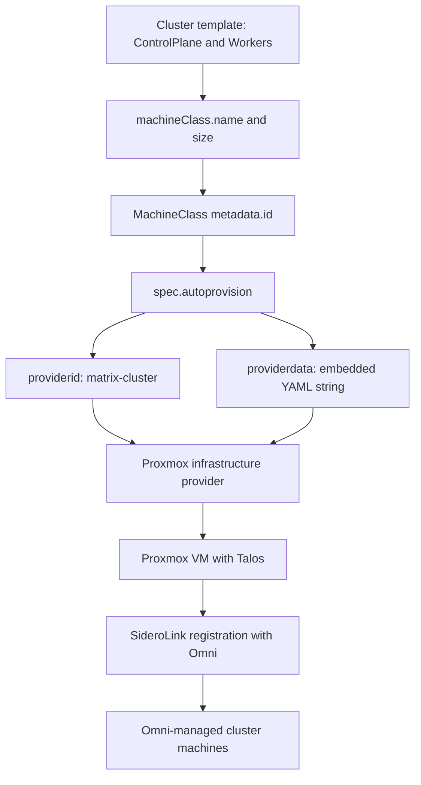

# Machine classes, templates and safe cluster changes

This repository owns the **Talos substrate**, not the applications installed on it. A cluster change crosses two distinct desired-state resources: machine classes describe provisioned VMs; cluster templates describe cluster membership, versions, extensions and Talos configuration. Applying one is not a substitute for reconciling the other.

See [Substrate architecture](../architecture/substrate.md) for the wider system and [GitOps handoff](../integrations/gitops-handoff.md) for post-bootstrap ownership.

## Resource and provisioning model

[Cluster templates](../../clusters/README.md) are multi-document YAML:

- `kind: Cluster` owns the cluster name, labels, Kubernetes/Talos versions and cluster-wide patches.
- Exactly one `kind: ControlPlane` describes the control-plane set.
- Multiple `kind: Workers` documents can describe independently named worker sets. Names must be unique; the default is `workers`.
- Each set can reference `machineClass.name` and `machineClass.size`, or list explicit machine UUIDs under `machines`; these alternatives are mutually exclusive. The template reference also documents `unlimited` worker size and optional rolling update/delete strategies. Those are capabilities, not settings enabled in the checked-in production template.

A machine-class reference resolves to the resource's `metadata.id`. The current classes are `MachineClasses.omni.sidero.dev` resources in namespace `default`, with empty `matchlabels` and an `autoprovision` specification. Their `providerid: matrix-cluster` matches the provider's default `--id`; `providerdata: |` embeds a second YAML document **as a string**, containing the provider-specific VM parameters.


*Provisioning flows from a template's class reference through provider selection and VM parameters to Talos registration.*

The provider is a separately deployed service, not code implemented in these YAML files. Registration also depends on boot-time network reachability: this deployment documents same-L2 provider/VM placement and LAN-resolvable Omni DNS for VMs that are not yet on Tailscale. A successful template validation does not prove that boot path works. See [Troubleshooting](../operations/troubleshooting.md).

## Checked-in production versus minimal test fixture

Use actual manifests rather than README examples as desired state:

| Property | Production: `clusters/talos-prod-01.yaml` | Minimal fixture: `clusters/test/test-cluster.yaml` |
|---|---|---|
| Cluster | `talos-prod-01`, label `environment: production` | `test-cluster` |
| Kubernetes / Talos | `v1.36.2` / `v1.13.6` | `v1.35.0` / `v1.12.0` |
| Control planes | Three from `matrix-control-plane` | One from `matrix-control-plane` |
| Workers | Three named sets, one machine each | Default worker set from `matrix-worker-hotel`, size `0` |
| Network patches | Default CNI set to `none`, kube-proxy disabled | No cluster patches |
| Extensions and worker mounts | Explicitly configured | None declared |

These are checked-in pins, **not a statement about the running cluster or Hub support**. The test directory contains an infrastructure fixture, not unit tests. Syncing it is a real provisioning action: it can create a control-plane VM even though its worker count is zero. It is not a miniature production-equivalence test because it omits the production CNI, extensions, topology and storage patches.

Production defines these VM and placement contracts:

| Class / set | VM sizing | Storage selector | Placement |
|---|---|---|---|
| `matrix-control-plane` | 4 cores, 1 socket, 8192 MB, 40 GB | `name == "local-lvm"` | No `node` pin |
| `matrix-worker-foxtrot` / `worker-foxtrot` | 8 cores, 1 socket, 16384 MB, 100 GB | `name == "vm_ssd"` | `node: foxtrot` |
| `matrix-worker-golf` / `worker-golf` | Same worker sizing | `name == "vm_ssd"` | `node: golf` |
| `matrix-worker-hotel` / `worker-hotel` | Same worker sizing | `name == "vm_ssd"` | `node: hotel` |

Control planes use local NVMe-backed `local-lvm` for etcd latency; workers use Ceph RBD `vm_ssd`. The production file's introductory comment says “on CEPH storage,” but the machine-class bodies make the control-plane exception explicit. All four classes use `vmbr0`, `cpu_type: host`, `machine_type: q35`, disabled ballooning, SSD emulation, discard, `disk_cache: none`, an IO thread and `disk_aio: io_uring`.

**Three control planes do not establish three-host placement.** The current single control-plane set uses one unpinned class. The machine-class README records that provider placement put all control planes on one node. This is a recorded deployment observation, not a permanent scheduling guarantee. Adding three `ControlPlane` documents to request one class per host is invalid: the template must contain exactly one. The limitation prevents this per-host-set pattern; it does not imply that the provider's `node` field cannot pin an entire shared class to one host.

For worker scaling, increase the intended named set's `machineClass.size`, then validate, diff and sync. Increasing `worker-golf`, for example, provisions against the Golf-pinned class; it does not create a new balanced set across all three hosts. Treat count reductions as removal changes, not harmless edits. Review any rolling strategy explicitly; the README's strategy examples are not active production policy.

## Provider fields and Talos node contracts

### Storage selectors are expressions, not objects

`storage_selector` is a **string CEL expression** inside the embedded provider data:

```yaml
providerdata: |
  cores: 8
  sockets: 1
  memory: 16384
  disk_size: 100
  network_bridge: vmbr0
  storage_selector: name == "vm_ssd"
  node: golf
```

This is an abbreviated example, not a full replacement class. Use storage `name` comparisons; the repository warns against `type == "rbd"` because `type` conflicts with CEL handling. Verify actual pool names with `pvesh get /storage` on Proxmox when provisioning fails. Consult the [provider-data reference](../../docs/references/providerdata-fields.md) for additional disks, NICs, VLANs, PCI mappings and advanced compute options. Those fields extend provisioning; listing them in reference examples does not activate them in current classes.

### Extensions, labels and Longhorn

Production declares `siderolabs/iscsi-tools`, `siderolabs/nfsd` and `siderolabs/util-linux-tools` on the control-plane set and every worker set. Availability must be checked for a target Talos release before upgrades; do not assume an extension name is enough to make a version supported.

Each worker set sets `topology.kubernetes.io/zone` to its pinned host name: `foxtrot`, `golf` or `hotel`. The `node-role.kubernetes.io/worker` label is deliberately commented out with a NodeRestriction warning. Do not copy README role-label examples into kubelet-managed `machine.nodeLabels` without checking admission constraints.

Every production worker also receives this kubelet bind mount:

```yaml
extraMounts:
  - destination: /var/lib/longhorn
    type: bind
    source: /var/local/longhorn
    options:
      - bind
      - rshared
      - rw
```

That worker-only `/var/local/longhorn` → `/var/lib/longhorn` mount is the substrate's Longhorn contract. Longhorn Helm configuration, StorageClasses, backup targets, RecurringJobs and restore procedures belong to `../mothership-gitops`, not to these templates.

The GPU examples in the cluster README and [GPU patch](../../clusters/patches/examples/gpu-worker.yaml) are **examples, not active production configuration**. Neither checked-in template references the patch. It includes example network addresses and a GPU role label; review both networking and NodeRestriction before adapting it.

## Safe command boundaries

Run commands from the repository root. Obtain an Omni configuration and verify the intended context before any authenticated operation (`omnictl config contexts`; `omnictl get clusters` triggers the documented OIDC flow). See the [operations guide](../../docs/OPERATIONS.md).

| Stage | Commands | What it establishes |
|---|---|---|
| Offline validation | `mise run validate:omni` | Runs `omnictl cluster template validate` on both checked-in templates. Does not authenticate or establish live compatibility, placement or health. |
| Authenticated inspection | `omnictl cluster template diff -f clusters/talos-prod-01.yaml` and `omnictl cluster template status -f clusters/talos-prod-01.yaml` | Preview differences and inspect template state against Omni. |
| Mutating class apply | `omnictl apply -f machine-classes/matrix-control-plane.yaml` | Writes the machine-class resource; repeat for the intended worker class files. Verify with `omnictl get machineclasses`. |
| Mutating reconciliation | `omnictl cluster template sync -v -f clusters/talos-prod-01.yaml` | Creates or changes cluster resources from the template; also the documented path for count changes. |
| Destructive deletion | `omnictl cluster template delete -f clusters/talos-prod-01.yaml` | Deletes cluster resources. Not validation, a reset step, or an ordinary upgrade command. |

Apply referenced classes before provisioning a cluster. Review both class changes and template diffs; a template reference alone does not show all embedded provider parameters. Do not treat a class edit as proof that existing VMs were resized or moved—verify the observed result in Omni and Proxmox. Watch `omnictl get machines -w`, inspect `omnictl get infraproviders`, and use provider logs when machines fail to appear.

For broader quality checks, see [Validation](../testing/validation.md). Offline success is one gate, not permission to mutate production.

## Version rollout: Hub gate, Talos, health, Kubernetes

The [recorded rollout procedure](../../.agents/skills/omni-update-rollout/SKILL.md) explicitly makes the live backend authoritative: **Omni Hub gates Talos; Talos gates Kubernetes**. A version edit or Renovate PR title is not sufficient evidence of compatibility.

1. **Triage dependencies.** Keep the `omnictl` pin matched to the Hub. Record deployed provider digest, upstream revision and proposed provider/Omni API requirements. The checked-in `local-fix` provider image is a historical reference requiring provenance reconciliation, not an evergreen workaround.
2. **Query the live compatibility gate:**

   ```bash
   omnictl get sysversion -o jsonpath='{.spec.backendversion}'
   omnictl get talosversions -o jsonpath='{.metadata.id}' | grep '^<target-talos>'
   omnictl get talosversion <target-talos> -o yaml | grep '<target-k8s>'
   ```

   If versions are absent, upgrade the Hub using [Hub lifecycle](../operations/hub-lifecycle.md), then repeat the gate. Do not repeatedly retry a rejected sync.
3. **Preflight.** Read target Talos release notes for config, CNI and extension changes. Check each template extension with `omnictl get talosextensions <ver> -o yaml`. Inspect `omnictl get etcdbackupstatus`; if empty, the procedure requires operator acknowledgment before a control-plane change. Start only from `omnictl cluster status <cluster>` reporting `RUNNING Ready` with healthy machines.
4. **Talos half.** Edit only `talos.version`, validate, commit and push desired state to main **before** sync. Poll cluster status, but verify every machine's Talos version using `omnictl get machinestatus -o json`; the aggregate Ready line can race the next phase.
5. **Health gate.** Require all nodes Ready, Cilium MTU `1450`, the Cilium DaemonSet fully ready, and zero degraded Longhorn volumes. Rebuilds after reboots may take time; wait and inspect rebuild progress rather than proceeding while degraded.
6. **Kubernetes half.** Change only `kubernetes.version` in its own commit and sync. The procedure describes staged control-plane components followed by kubelets, without node reboots. Confirm every node reports the target Kubernetes version and repeat the health checks.
7. **Close out.** Record what was applied and update other affected pins or operational instructions in the same session.

Stop on a failed health gate. The local operational doctrine is to investigate a wedged node and destroy/recreate it from spec rather than migrate or hand-patch it. Historical repository warnings about migration and SideroLink identity motivate that policy; they should not be read as an unqualified upstream guarantee that every Talos/Proxmox migration necessarily fails.
