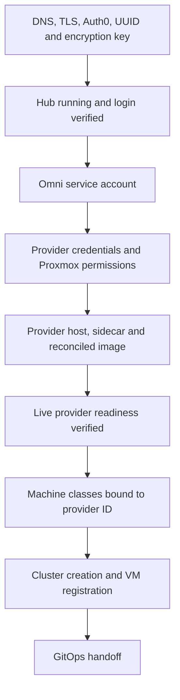

# Deploy the Hub and Proxmox provider

This workflow takes the substrate from external prerequisites to a provider that can actually provision Talos VMs. The Hub owns management state and APIs; the Proxmox provider authenticates to Omni and creates resources through the Proxmox API. A registered provider object is **not** proof that the provider process is connected or able to provision.

Use the [deployment runbook](../../docs/DEPLOYMENT.md) for detailed installation steps, but treat the checked-in [Hub Compose](../../omni/compose.yml) and [provider Compose](../../proxmox-provider/compose.yml) as configuration authority over embedded historical YAML. This is a first-install route, not a reset or upgrade procedure. For an existing installation, start with [Hub lifecycle](../operations/hub-lifecycle.md).


*Dependency gates for first deployment: do not advance from registration directly to cluster creation.*

## 1. Establish network and identity prerequisites

**Execution context:** workstation, DNS/Tailscale/Auth0 administration consoles, Hub VM, and Proxmox node administration. Follow [Build Checklist](../../docs/DEPLOYMENT.md#0-build-checklist), [Prerequisites](../../docs/DEPLOYMENT.md#1-prerequisites), and [DNS Architecture](../../docs/DEPLOYMENT.md#dns-architecture).

**Prerequisites and actions:**

- Prepare distinct Tailscale auth keys for Hub and worker. If advertising tags, authorize those tags in the tailnet ACLs.
- Configure Auth0 as a Single Page Application with the Hub URL in callback, logout, and origin settings, and an enabled identity connection. The `--auth-auth0-domain` value must be a hostname **without** `https://`.
- Generate the installation UUID and export the GPG secret key used by Omni storage encryption. Prepare TLS certificate and private-key files for the advertised Hub hostname; the runbook uses Cloudflare DNS-01.
- Establish split-horizon DNS: administrators and the provider can use the tailnet route, but fresh Talos VMs must resolve the Hub hostname to a reachable LAN address. Configure Proxmox node DNS for the local resolver, rather than a public resolver that bypasses the split view.

**Risk:** a browser working over Tailscale does not prove that an unauthenticated VM can reach Omni. Different public/internal hostnames can also produce certificate-name mismatches. Do not treat the worker LXC's historical resolver workaround as the DNS policy for Talos VMs or Proxmox nodes.

**Expected result and checks:** resolve the same Hub hostname from tailnet and LAN contexts and verify the intended addresses and routes. Confirm certificate names, file availability, Auth0 settings, and the Hub's LAN IP before startup. See [Network and identity](../concepts/network-and-identity.md) for the cross-component model.

## 2. Configure and start the Hub

**Execution context:** Docker-capable Hub VM, inside the deployed `omni/` directory. Follow [Phase 1: The Omni Hub](../../docs/DEPLOYMENT.md#31-phase-1-the-omni-hub-cluster-a), using [omni.env.example](../../omni/omni.env.example) and current Compose rather than copying the runbook's YAML.

**Prerequisites:** stage 1 complete; `/dev/net/tun` available; certificate, encryption-key and persistent-storage paths prepared. Copy the example to `omni.env` locally and populate it securely. Reconcile these settings together:

| Configuration | Required relationship |
|---|---|
| `HOST_IP` | Actual Hub LAN IP reachable by Talos VMs; Compose publishes ports here. |
| `ADVERTISED_API_URL`, `ADVERTISED_K8S_PROXY_URL` | Correct browser/API and Kubernetes-proxy hostname and ports. |
| `SIDEROLINK_ADVERTISED_API_URL`, `SIDEROLINK_WIREGUARD_ADVERTISED_ADDR` | Machine API hostname on port 8090 and reachable LAN WireGuard endpoint on UDP 50180. |
| `ETCD_VOLUME_PATH`, `OMNI_SQLITE_PATH` | Persistent host directory mounted at `/_out/etcd`, with the database path inside it. |
| `ETCD_ENCRYPTION_KEY`, `TLS_CERT`, `TLS_KEY` | Existing host files mounted read-only into Omni. |
| `OMNI_ACCOUNT_UUID`, `INITIAL_USER_EMAILS`, `AUTH` | Installation identity, bootstrap administrator identities, and Auth0 configuration. |

**Always supply `--env-file omni.env` for Hub Compose interpolation.** The service-level `env_file: omni.env` populates container environment variables; it does not itself supply parse-time `${...}` values for mounts, commands, or port mappings.

```bash
# On the Hub VM, from omni/
docker compose --env-file omni.env config --quiet
docker compose --env-file omni.env up -d
docker compose --env-file omni.env ps
docker compose --env-file omni.env logs --tail=50 omni
```

**Mechanism:** Omni shares the `omni-tailscale` network namespace and starts after that sidecar's health check passes. LAN ports are published on the sidecar: TCP 443, 8090, 8100 and UDP 50180. Both services receive TUN access; Omni receives `NET_ADMIN`. Compose supplies SQLite storage and explicit TLS certificates for both browser and machine APIs.

**Risk:** interpolation mistakes can select wrong mounts or addresses. Full rendered Compose output can expose credentials: use quiet validation and do not paste environment files or unredacted inspection output into tickets. Persistent state and its encryption key are not disposable bootstrap artifacts.

**Expected result and checks:** Compose services are running, logs have no startup/configuration failure, the UI is reachable through the intended routes, and Auth0 login succeeds. A healthy Tailscale check alone is not a Hub API or login test.

## 3. Create provider identity and authorize Proxmox access

**Execution context:** Omni UI for the service account; Proxmox administrative shell/UI for user, token and ACLs; worker deployment directory for secret files. Use [Create Service Account](../../docs/DEPLOYMENT.md#phase-15-create-service-account-detailed) and [Proxmox permissions](../../.agents/skills/omni-talos/references/proxmox-permissions.md).

**Prerequisites:** successful Hub login and administrative access to Proxmox. Create the provider service account and save its key immediately: the UI shows it only once. Put it in `OMNI_SERVICE_ACCOUNT_KEY` in the worker's local `.env`, **not** in committed Compose YAML.

Copy [provider .env.example](../../proxmox-provider/.env.example) and [config.yaml.example](../../proxmox-provider/config.yaml.example) to local `.env` and `config.yaml`. Set the worker Tailscale key, `OMNI_API_ENDPOINT`, and `PROVIDER_ID`; keep the provider ID consistent with Omni and future machine classes. The Proxmox API URL, `tokenID` and `tokenSecret` belong in `config.yaml`, which Compose mounts read-only.

Use a dedicated Proxmox user/API token rather than root. Review the permission reference's VM allocation, disk/CPU/memory/network/options configuration, power management, and datastore allocation/audit privileges. Verify **effective token permissions**, not just the user's role: token privilege separation and ACL scope must allow the intended operations. The reference's role commands are a starting point, not a provisioning acceptance test.

**Risk:** Proxmox token values are also only available at creation. The example's `insecureSkipVerify: true` disables Proxmox server-certificate verification; make that an explicit trust decision, not a default security guarantee. Never commit actual tokens, keys or populated configuration files.

**Expected result and checks:** from the worker's network context, test Proxmox API access and storage visibility using the reference's [Verifying Access](../../.agents/skills/omni-talos/references/proxmox-permissions.md#verifying-access) procedure with locally supplied credentials. Version discovery alone does not prove permission to create VMs.

## 4. Prepare the worker and reconcile the image before deployment

**Execution context:** Proxmox host for LXC configuration; Docker inside the provider LXC for Compose and image inspection. The provider setup reference identifies `omni-provider`, CT 200 on Foxtrot; confirm the actual target before acting. Follow [Worker host setup](../../docs/DEPLOYMENT.md#32-phase-2-the-worker-cluster-b) and [Provider setup](../../.agents/skills/omni-talos/references/provider-setup.md).

**Prerequisites:** nesting and TUN access for the unprivileged LXC, populated local credentials, and a verified image choice. The worker sidecar uses `TS_USERSPACE=false`, `/dev/net/tun`, and network capabilities; the provider shares its namespace and waits for sidecar health. A working `tailscale ping` alone does not prove kernel networking is usable by the application.

> **Image-change gate:** `:local-fix` in checked-in provider Compose is historical desired-state debt. It is neither a mandatory patched build nor a safe redeployment choice. Upstream moved hostname delivery to NoCloud metadata. Neither `latest` nor `local-fix` proves contents, freshness or compatibility.

Before using `up`, reconcile the desired image with a verified artifact. For an existing provider, follow [Provider Image](../../.agents/skills/omni-talos/references/provider-setup.md#provider-image): discover the running container by Compose service label, require exactly one match, inspect its image ID/digest and revision metadata, and compare with upstream manifests/build provenance. For a new install, establish equivalent provenance for the selected registry artifact. Reconcile provider/Omni API compatibility before any image change; record dated evidence in the change record rather than treating tags as inventory.

Only after resolving that gate, from the worker's `proxmox-provider/` directory:

```bash
docker compose config --quiet
docker compose up -d
docker compose ps
docker compose logs --tail=50 proxmox-provider
```

**Risk:** blindly replaying initial-setup commands can replace a functioning image with the unresolved historical reference. Keep rendered configuration and logs containing secrets private.

**Expected result and checks:** the sidecar is healthy and the provider process stays running without endpoint, authentication or Proxmox API errors. Continue to the live-health gate; container uptime is insufficient.

## 5. Prove live provider readiness

**Execution context:** authenticated `omnictl` workstation; optionally the worker Docker host. Install and configure the CLI using [Operations sections 1–3](../../docs/OPERATIONS.md#1-cli-installation).

**Prerequisites:** provider process started, matching provider identity, correct Omni endpoint and both credential sets. For the repository's default provider ID:

```bash
omnictl get infraprovidercombinedstatus matrix-cluster
omnictl get infraproviderhealthstatus matrix-cluster
omnictl get infraproviderstatuses
```

Substitute your reconciled ID if different. Inspect live health and combined status, not merely `omnictl get infraproviders`: registration objects can exist without a connected provider. Confirm **Infrastructure > Providers** shows Connected and inspect reported resources and provider logs.

Optional workstation-side container checks use the actual helper location:

```bash
.agents/skills/omni-talos/scripts/provider-ctl.py --status
.agents/skills/omni-talos/scripts/provider-ctl.py --logs 50
```

The helper defaults to Tailscale SSH through `root@foxtrot`, then `pct exec 200`; it discovers the container by Compose service label and rejects missing or ambiguous matches. Set `OMNI_PROVIDER_HOST`, `OMNI_PROVIDER_CT`, or other supported overrides when targeting a different installation. Its status reports container running/health state, **not** Omni provisioning readiness.

**Risk:** mistaking registration or container uptime for live readiness defers credential/routing failures until cluster creation. **Expected result:** live Omni health, connected UI state, usable Proxmox resources and quiet provider logs agree. Stop here if they do not; use [Troubleshooting](../operations/troubleshooting.md), not state deletion.

## 6. Apply classes, create the cluster, and hand off

**Execution context:** authenticated workstation in the repository root. **Prerequisites:** stage 5 passed; review real storage names, bridges, placement and VM capacity. Follow [Machine Classes](../../docs/OPERATIONS.md#4-machine-classes) and [Cluster Management](../../docs/OPERATIONS.md#5-cluster-management), then [Cluster changes](cluster-changes.md).

Machine classes pass `autoprovision.providerid` and provider-specific VM settings to the provider. For example, the checked-in control-plane class targets `matrix-cluster`, `vmbr0`, and `local-lvm`; those are deployment choices to validate, not universal defaults. Apply the reviewed classes, verify `omnictl get machineclasses`, and only then sync the reviewed cluster template.

**Risk:** cluster template sync is a mutating operation that can initiate VM provisioning. Wrong provider IDs or storage selectors prevent useful provisioning even when the provider is connected.

**Expected result and checks:** watch `omnictl get machines -w`; verify Proxmox VM creation, stable boot, green SideroLink, node registration/join, and healthy cluster control-plane components. The provider handles VM creation; manual ISO/template provisioning is not required for this route.

The substrate boundary ends at a reachable cluster and bootstrap handoff. Continue with [GitOps handoff](../integrations/gitops-handoff.md): platform reconciliation, ArgoCD applications, storage/backup values, secrets integration, ingress and workloads belong to `../mothership-gitops`, not this deployment workflow.

**Do not use historical “nuclear options” as first-install troubleshooting.** Wiping Hub storage can leave physical VMs orphaned relative to management state. Preserve data and keys, diagnose the failed gate, and use lifecycle/recovery procedures before any destructive reset.
