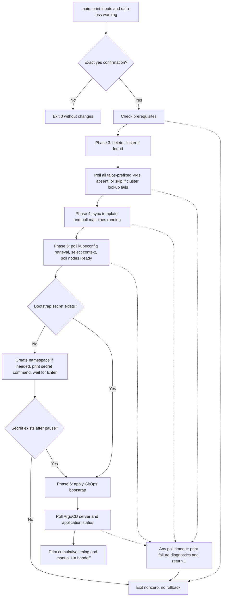

# Destructive cluster rebuild and recovery limits

## Safety and prerequisites first

**This procedure destroys the selected cluster. Treat all workloads and data as lost.** It recreates infrastructure from declarative specifications; it does not restore workload data, backups, or Omni Hub state. There is no rollback, backup, or automatic compensation path in the script. A failed run can leave the old cluster deleted and the replacement only partially provisioned.

Run from the repository root using either entrypoint:

```bash
mise run disaster-recovery
# Or directly:
./scripts/disaster-recovery.sh
```

The task is just a wrapper around [disaster-recovery.sh](../../scripts/disaster-recovery.sh). `main` prints the resolved inputs and destruction warning, then requires the exact response `yes`. Any other response exits successfully without running prerequisites or destruction. There is no noninteractive approval flag or dry-run mode.

Before approving, arrange:

- **Bash with associative-array support (Bash 4+).** The script uses `declare -A`, `BASH_SOURCE`, and `set -euo pipefail`; do not invoke it through `sh` or an older Bash such as the stock macOS Bash 3.2.
- `omnictl`, `kubectl`, `jq`, and `tailscale` on `PATH`, plus normal shell utilities. `omnictl get clusters` must succeed against the intended, already-running Hub.
- Working **Tailscale SSH as `root@foxtrot`, `root@golf`, and `root@hotel`**. Preflight tests `true` on each host; VM inspection later requires remote `pvesh` access. This is Tailscale SSH, not a local SSH alias or arbitrary kubeconfig context.
- The cluster template and local GitOps bootstrap file. The default bootstrap comes from a sibling checkout of [mothership-gitops](https://github.com/basher83/mothership-gitops); a configurable file path is still an external dependency, not bootstrap content owned by this repository.
- An executable provider-control helper. The checked-in helper uses `uv run --script` and Python `>=3.11`; have that runtime available for diagnostics. Preflight only checks executability, not that its runtime or remote provider operations work.
- Infisical client credentials available securely for manual secret recreation. The script checks secret existence, not credential validity.
- **An already deployed, functional Omni Proxmox provider and the referenced machine classes.** The script syncs a cluster template, not provider infrastructure or machine-class resources. The production template needs `matrix-control-plane`, `matrix-worker-foxtrot`, `matrix-worker-golf`, and `matrix-worker-hotel`.

Preflight checks binaries, files, Omni access, helper executability, and host connectivity. It does not validate the template offline, verify provider health, create machine classes, verify Infisical credentials, or prove that a fresh cluster can become Ready. See [Deploy substrate](deploy-substrate.md) and [Hub lifecycle](../operations/hub-lifecycle.md) for the infrastructure outside this workflow.

## Configuration and blast radius

Defaults are derived from the script location, not the caller's working directory. With `REPO_ROOT` as this checkout and `LAB_ROOT` as its parent:

| Environment override | Default | Responsibility |
| --- | --- | --- |
| `CLUSTER_NAME` | `talos-prod-01` | Cluster deletion, machine selection, kubeconfig retrieval, context name |
| `CLUSTER_TEMPLATE` | `$REPO_ROOT/clusters/talos-prod-01.yaml` | Template synced to recreate the cluster |
| `GITOPS_BOOTSTRAP` | `$LAB_ROOT/mothership-gitops/bootstrap/bootstrap.yaml` | Local file required before deletion and later applied with `kubectl` |
| `EXPECTED_MACHINES` | `6` | Exact count required by both machine and node gates |
| `PROVIDER_CTL` | `$REPO_ROOT/.agents/skills/omni-talos/scripts/provider-ctl.py` | Provisioning-timeout diagnostic helper |

Changing `CLUSTER_NAME` does **not** rewrite the template's `name`. Keep name, template, and expected machine count consistent yourself. The checked-in [production template](../../clusters/talos-prod-01.yaml) requests three control planes and three workers, with one worker class for each host.

**The VM cleanup check is broader than the cluster selection.** Deletion requests `omnictl cluster delete "$CLUSTER_NAME"`; the script does not directly delete VMs with `qm` or `pvesh`. It then counts **every VM whose name starts with `talos` across all three hard-coded hosts**, regardless of cluster label or ownership. This includes names without a hyphen after `talos`. A different Talos cluster can keep the cleanup gate from passing. Cluster/template overrides do not narrow this check, and `PROXMOX_HOSTS=(foxtrot golf hotel)` is not an environment override.

If the initial `omnictl get cluster` fails, destruction is skipped entirely, including the VM cleanup wait. The script interprets any failure as “does not exist”; it does not distinguish absence from an access or transport failure at that point.

## Phase and failure flow



The script's `main` runs phases sequentially; timeout diagnostics do not recover or resume the workflow. Other unhandled command failures also stop execution under `set -e`.

### Exact gates and diagnostics

`poll_until` checks immediately, suppresses check stderr, and retries after 10-second sleeps. At its timeout it prints an error, runs the supplied diagnostic command with failure tolerated, and returns `1`. Because phase calls in `main` are not guarded, this aborts the run before later phases and the completion summary.

| Phase | Pass condition | Poll timeout | Timeout diagnostics |
| --- | --- | --- | --- |
| 3: destroy | Aggregate count of `talos`-prefixed VMs is zero on Foxtrot, Golf, Hotel | 600 s | Remaining matching VM names per host |
| 4: recreate | Cluster-labelled machine array has exactly `EXPECTED_MACHINES` entries and all `.spec.phase == "running"` | 1,200 s | Machine listing and `"$PROVIDER_CTL" --logs 50` |
| 5a: API | `omnictl kubeconfig "$CLUSTER_NAME" --merge` succeeds | 600 s | Machine listing |
| 5b: nodes | Exactly `EXPECTED_MACHINES` Kubernetes nodes, each with a `Ready=True` condition | 600 s | Wide node list and node conditions |
| 6a: ArgoCD | `argocd-server` deployment's `availableReplicas` output matches a nonzero digit | 300 s | ArgoCD pods and last 20 time-sorted events |
| 6b: apps | Application list in `argocd` is nonempty and every app is `Synced` and `Healthy`, except `argocd-ha` | 1,200 s | Application name, sync, and health table |

The API gate is specifically a successful kubeconfig retrieval, not an independent API health probe. After it passes, the script fetches/merges kubeconfig again and switches the active context to `omni-$CLUSTER_NAME`, affecting subsequent local `kubectl` commands.

The provisioning diagnostic helper defaults to Tailscale SSH into `root@foxtrot`, then `pct exec 200`, then Docker logs from the container discovered by Compose service label `proxmox-provider`. Its `OMNI_PROVIDER_HOST`, `OMNI_PROVIDER_CT`, `OMNI_PROVIDER_SERVICE`, and `OMNI_PROVIDER_CONTAINER` overrides affect that diagnostic target, not the rebuild's three-host VM scope. The rebuild does not call the helper's restart action.

## Critical fresh-cluster ordering gap

**The checked-in production path is not an unattended recovery procedure.** The template explicitly sets CNI to `none` and disables kube-proxy. The script then waits for **all nodes Ready before applying GitOps**, but contains **no Cilium installation step**. The [Cilium guide](../../docs/guides/CILIUM.md) describes imperative Cilium installation and states that no ArgoCD Application manages it.

On a fresh rebuild, missing CNI can therefore block the node readiness gate and cause the script to exit before bootstrap. Do not assume that applying GitOps later will fix an earlier gate. Plan a separate Cilium installation after API access exists and before the node gate must pass, using the guide's Talos-specific settings, including its `MTU=1450` requirement. This is an operator intervention or a script-ordering change, not existing automation. Validate with `cilium status --wait`, `kubectl get nodes`, and, where appropriate, `cilium connectivity test`.

## Manual secret pause and GitOps handoff

Only after node readiness does the script ensure the `external-secrets` namespace exists. If `universal-auth-credentials` is missing, it prints this command and waits for Enter:

```bash
kubectl create secret generic universal-auth-credentials \
  --from-literal=clientId=<INFISICAL_CLIENT_ID> \
  --from-literal=clientSecret=<INFISICAL_CLIENT_SECRET> \
  -n external-secrets
```

Create it in another terminal with the correct cluster context and appropriate credential-handling precautions. After Enter, the script checks once more and exits `1` if the secret is still absent. There is no timeout on this human pause, no automated Infisical login, and no secret-content validation.

The script then applies `GITOPS_BOOTSTRAP` and observes ArgoCD availability and application status. Application implementation belongs to [mothership-gitops](https://github.com/basher83/mothership-gitops), not this infrastructure repository; see [GitOps handoff](../integrations/gitops-handoff.md).

A passing app gate excludes `argocd-ha` from both sync and health requirements. The completion summary explicitly hands off optional HA synchronization:

```bash
kubectl -n argocd patch application argocd-ha --type merge -p '{"operation":{"initiatedBy":{"username":"admin"},"sync":{}}}'
```

Neither this status gate nor the completion banner proves application-level recovery, restored persistent data, or HA operation.

## Timing, validation, and recovery after failure

The source banner and [scripts README](../../scripts/README.md) advertise **30–45 minutes**, but this is an estimate, not a guarantee. The six configured polling budgets alone total **4,500 seconds (75 minutes)**. Poll elapsed counters count sleeps rather than command runtime; SSH and other commands can take additional time, and the manual secret pause has no bound. The script's timeout constants are assigned in source, not configurable through the documented environment overrides.

`START_TIME` is captured when the script loads, before confirmation. Recorded phase times are **cumulative elapsed seconds since that start**, not individual phase durations, and include interactive waiting. If destruction is skipped, no destroy timing is recorded. The final summary is only reached after all gates pass.

Before a live drill, run the non-destructive quality gates:

```bash
mise run validate:omni
mise run check
```

The first validates checked-in production and test Omni templates offline. The second runs pre-commit checks, including ShellCheck and shfmt; CI invokes that same quality gate. These checks do not exercise live destruction, VM cleanup, CNI ordering, secret recreation, or application recovery. See [Validation](../testing/validation.md).

After failure, preserve the emitted diagnostics, determine which state already changed, and inspect Omni machines, provider logs, nodes, or ArgoCD as appropriate. **Do not blindly rerun:** there is no phase-resume mechanism, and a new confirmed run starts at deletion again, potentially destroying the partially rebuilt cluster. Resolve prerequisites and the CNI gap before attempting another drill. See [Troubleshooting](../operations/troubleshooting.md) for operational diagnosis.
